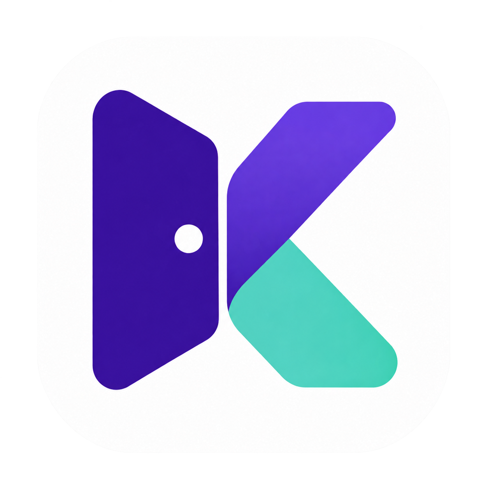

<p align="center">
  
</p>
<h1 align="center">KoKo（叩叩）</h1>
<p align="center">
  <strong>零公网暴露的极致内网远程桌面 —— 为局域网、Tailscale / ZeroTier 组网与 AI Agent 而生</strong>
</p>
<p align="center">
  <a href="https://github.com/Kizai/koko/releases">下载内测版</a> ·
  <a href="#快速开始">安装与使用</a> ·
  <a href="./docs/README.md">文档</a> ·
  <a href="./docs/overview.md">English</a>
</p>

---

## 为什么做 KoKo？

传统公网远控软件依赖云端信令和高带宽中继服务器。一方面，**公网暴露面在 AI 自动化攻击时代极其脆弱**，任何挂在公网上的信令或中继服务器都是活靶子；另一方面，中继传输常常带来卡顿、限速与不可控的稳定性问题。

**KoKo 选择彻底不用公网云端中继（No Cloud, No Relay）。** 它用 **Rust + iroh / QUIC** 构建纯点对点直连核心，专为**局域网、Tailscale / ZeroTier 虚拟组网以及公司、学校机房等隔离内网**打造：把网络边界交给你信任的内网，把画质、延迟和 AI 操控的安全性做到极致。

这是 KoKo 的设计取向，而不是暂时的限制：远程连接不经过任何 KoKo 或第三方服务器，只在你的两台设备之间按 IP 直连，内网完全断网也能使用（只有检查更新会访问 GitHub Releases）。

## 核心特性

- **🔒 零公网暴露，安全与稳定兼得（Zero-Cloud / Local-First）**
  不依赖任何第三方云端信令或中继服务器，从根源上消除公网攻击面与中继带宽瓶颈。支持局域网自动发现、9 位设备 ID + 验证码配对与信任设备重连，适配 **Tailscale、ZeroTier、WireGuard** 及公司、学校隔离内网。验证码只以与双方设备密钥绑定的证明形式传输，连续输错会被锁定。

- **⚡ 原生级画质与跟手交互**
  深度调用 macOS 原生管线（ScreenCaptureKit / VideoToolbox / AVFoundation），支持 **HEVC 4:4:4 FullRange** 全色度编码、**30–240 FPS** 目标帧率档位与 **AAC-ELD** 10ms 低延迟音频。通过 `⌘C / ⌘V` 跨机收发文字、图片、文件与文件夹（不限大小），并复用系统 SSH 提供终端与端口转发。

- **🤖 为 AI Agent 打造的人机协同安全控制面（MCP）**
  人类与 Agent 共享同一套 Rust 底层授权，内置 MCP 服务，支持截图、读取界面元素与键鼠操作。针对 Computer Use 的安全痛点内置护栏：**删除、付款、退出应用、终端命令等高危操作必须经被控端二次确认**；被控端本机只要动一下键鼠，就会立即暂停 Agent 并由人接管。

## 适用场景

- **多台 Mac 协同与 Homelab**：在内网或 Tailscale 组网下，用笔记本操控 Mac Studio / Mac mini，获得接近本地显示器的 4:4:4 清晰度。
- **本地 AI Agent 托管**：让 Claude、Codex 等 Agent 接管内网闲置电脑执行自动化任务，全程可控、随时接管。
- **高保密内网与机房环境**：设计、影视工作室的素材防泄密，公司研发内网，学校机房等断网或零公网暴露的远程协作场景。

## 当前版本

首个内测版支持 **macOS 13 及以上**，提供适用于 Apple Silicon 和 Intel 的通用 DMG。可在同一局域网，或两台设备能直接互通的组网环境（Tailscale、ZeroTier、WireGuard、企业 VPN 等）中使用。

| 功能 | 当前可用 |
| --- | --- |
| 配对 | 9 位设备 ID + 验证码、局域网发现、组网直连邀请、信任设备重连 |
| 远程桌面 | HEVC（4:4:4 / 4:2:0 FullRange）与 H.264 硬件推流、`AAC-ELD` 低延迟远端音频、多显示器、观看模式、鼠标和键盘（含修饰键与输入法切换） |
| 会话剪贴板 | 通过 ⌘C / ⌘V 双向传输文字、图片、文件和文件夹，大文件连续传输、不限大小（两端需 0.1.22 起） |
| 被控端发送文件 | 被控时拖动文件会出现发送浮窗，拖入即可发给控制端（两端需 0.1.22 起） |
| 画面设置 | 传输分辨率、画质、30–240 FPS 目标档位与实测接收帧率 |
| 设备工具 | 单文件收发、终端、两端 localhost 端口转发，使用系统 SSH |
| Agent 接入 | MCP：设备列表、配对、截图、读取界面元素、鼠标与键盘、向被控端求助；删除、付款、退出应用、终端命令等高危操作需被控端确认；被控端可随时停止或接管 Agent，本机动一下键鼠即可暂停它。另有发现、配对、截图与输入 CLI |

## 快速开始

### 1. 下载并安装

在 [GitHub Releases](https://github.com/Kizai/koko/releases) 打开内测版，下载 `Koko-<版本>.dmg`。从 0.1.15 起，在两台 Mac 上分别打开同一版本的 DMG，双击其中的安装图标，跟随 macOS 安装器完成安装。然后从「应用程序」打开 KoKo。以前的 DMG 可将 `Koko.app` 拖入「应用程序」。安装预编译包只需要 macOS。

从 0.1.16 起，打开 KoKo 或回到主窗口时，应用每天最多自动检查一次 GitHub Releases。有新版 Mac 安装包时，主窗口会显示提醒。点「查看并更新」会打开更新窗口，显示新版本的更新说明；点「立即更新」后，同一条进度条依次显示下载、校验解压和安装，完成后 KoKo 自动重新启动。0.1.21 更换了更新签名密钥并改用自签名证书，0.1.20 及更早版本的用户需要用 DMG 手动升级到 0.1.21 一次，之后的版本可以应用内更新。也可随时点击右上角「设置 → 常规 → 检查更新」。0.x 内测版会检查预发布版本，只有源码的发布会被跳过。

0.1.20 及更早的内测版使用临时签名，每次升级都要重新授予录屏和辅助功能。之后的内测版使用固定的 KoKo 自签名证书，从旧版升级时最后授权一次，以后升级不再需要。升级后可先从「设置 → 安全」复查已有授权。[权限与签名说明](./docs/macos-permissions.md)

### 2. 被控端开启共享

1. 首次打开 KoKo，跟随权限引导逐项开启。之后可从「设置 → 安全 → 权限设置」再次打开。**屏幕录制**用于分享画面，**辅助功能**用于接收键鼠。
2. 按 KoKo 的提示进入「系统设置 → 隐私与安全性」，为应用授权。权限页会自动复查。若系统要求重启，可点「重开 Koko 并复查」回到此页。可点击「测试本机画面」先确认录屏可用。
3. 打开「本机共享」中的 **允许远程协助**。默认监听 `0.0.0.0:27688/UDP`（若被占用会自动顺延到可用端口）。两台 Mac 若收到本地网络权限提示，请允许 KoKo 在局域网发现和连接设备。

### 3. 控制端选择连接方式

| 使用场景 | 操作 |
| --- | --- |
| 同一个局域网 | 点击侧栏的刷新图标，选择设备并进入桌面。被控端可选择「仅允许这次」或「信任并连接」。 |
| 有设备 ID 和验证码 | 把被控端的 9 位设备 ID 填入「连接伙伴」，按提示输入验证码。临时验证码在每次远程会话结束后刷新；也可以在被控端设置 8–16 位、同时包含字母和数字的自定义验证码。连续输错 5 次后被控端会暂停校验一段时间。 |
| Tailscale / ZeroTier 等组网，或局域网发现失败 | 从被控端复制直连邀请，粘贴到控制端的「连接伙伴」。组网需要能访问被控端的 UDP 监听端口（默认 27688）。 |

连接后，直接点击远程画面使用鼠标和键盘。在顶部切换显示器，在「控制中心」调整画质、传输分辨率或目标帧率。被控端关闭「允许远程协助」即可结束当前会话。若需要撤销已记住的控制端，使用「设置 → 安全 → 清除信任」。[完整双机测试指南](./docs/macos.md)

## 常见问题

- **能连接但没画面。** 在被控 Mac 上先运行「测试本机画面」。升级后若系统开关已开启，但 KoKo 仍显示「未授权」，核对系统记录对应的是否是「应用程序」里的当前版本。[macOS 权限排查](./docs/macos-permissions.md)
- **能看画面但点不了。** 检查被控端的辅助功能权限，并用「进入桌面」打开可操作会话。实体键盘需要先点击画面取得焦点。
- **目标帧率和实际帧率不同。** 在被控端持续滚动画面，再从顶部网络状态查看「接收帧率」。实际接收速度取决于显示器更新、编解码和网络。
- **如何操作锁屏的 Mac？** 被控端已开启系统屏幕共享时，可从「控制中心」打开 macOS「屏幕共享」，由系统负责登录。[锁屏和按键说明](./docs/macos.md#画面与按键映射)
- **如何传文件或开终端？** 在局域网设备卡片打开所需工具。被控 Mac 需要开启「远程登录」并授权对应账户。文件收发和端口转发使用 SSH 密钥及已验证的主机指纹。[设备工具配置](./docs/macos.md#设备工具与设置)

## 技术架构

| 层次 | 实现 |
| --- | --- |
| 协议和传输 | Rust 的 `koko-proto` 定义消息，`koko-p2p` 使用 iroh / QUIC 完成身份认证与传输（`presets::Minimal`：不启用中继和外部地址发现，只按 IP 直连），并用 mDNS 发现局域网设备 |
| 会话和命令行 | Rust 的 `koko-daemon` 负责被控端会话与授权，`koko-agent` 提供控制端 CLI 并收发画面和输入 |
| macOS 原生层 | Swift / SwiftUI 负责窗口和权限流程，调用 ScreenCaptureKit 采集、VideoToolbox 编码、AVFoundation 显示和 Core Graphics 投递键鼠 |

低内存和低延迟是项目目标。性能评估以整条链路为单位，包括控制端辅助进程、编解码和帧缓冲。[当前实现与架构规划](./docs/architecture.md#性能边界)

## 命令行与 Agent

安装后可直接运行包内的 Rust CLI。下面的第二条命令需要替换成被控端显示的 9 位设备 ID 或直连邀请。

```bash
/Applications/Koko.app/Contents/Helpers/koko-agent discover
/Applications/Koko.app/Contents/Helpers/koko-agent pair 253153157
```

配对成功后返回 `host_id` 和 `address`。脚本可以用这两个字段发起已授权的截图或输入请求。[CLI 与 MCP 使用](./docs/macos.md#agent-与-mcp)

## 从源码构建

在 Mac 上安装 [Rust 工具链](https://rust-lang.org/tools/install/) 和 Xcode Command Line Tools，再克隆仓库并构建。

```bash
git clone https://github.com/Kizai/koko.git
cd koko
./scripts/build-macos.sh --allow-ad-hoc
```

本地临时包输出到 `target/koko-macos/local/`。公开发布时，配置 Developer ID 签名和公证凭据，执行 `./scripts/build-macos.sh --release`，将同版本的 DMG、更新 ZIP 和 appcast.xml 附到 GitHub Release。[构建与签名](./docs/macos.md#公开分发与升级)

```bash
cargo fmt --all -- --check
cargo clippy --workspace --all-targets --locked -- -D warnings
cargo test --workspace --locked
```

## 路线图与贡献

KoKo 不会加入公网中继或云端信令，跨网络远程交给 Tailscale、ZeroTier 等你自己掌控的组网。接下来的重点：

- **极致内网画质与延迟**：已实现逐帧确认的在途帧窗口与码率自适应；下一步是解码后用 Metal 直接呈现、适配 120/165 Hz 显示器，向 1440p 高帧率推进。
- **Agent 能力**：MCP 已支持截图、读取界面、键鼠和向人求助，高危操作需被控端确认；下一步是双机实机验收和资源开销评估。
- **更多平台与内网管控**：在 macOS 体验打磨完成后，再扩展 Windows / Linux 被控端，以及面向公司内网和学校机房的批量部署、集中管理与操作审计。

可以通过 [Issues](https://github.com/Kizai/koko/issues) 提交反馈，附上 KoKo 与 macOS 版本、连接方式、复现步骤和预期结果。请省略验证码和私钥等信息。改动前请阅读[开发规则](./docs/development.md)。

## 开源协议

KoKo 使用 GNU 通用公共许可证第 3 版（GPL-3.0）。[查看许可证](./LICENSE)
