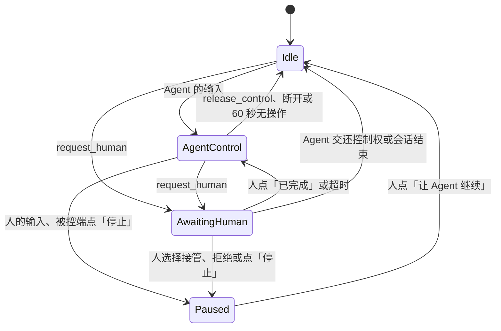

# Agent 与 MCP 设计规范

[返回文档目录](./README.md)

本文定义 KoKo 的核心能力：AI Agent 通过 MCP 识别并操作已授权的远程 Mac，被控端的人可以随时看到、停止和接管。M1 只读 MCP、M2 Agent 操作、M3 人工协作、M4 界面树和 M5 高危操作审批都已实现，各里程碑的状态见[里程碑与验收](#里程碑与验收)。现有协议见[架构设计的当前实现](./architecture.md#当前实现macos-内测版)，交付顺序见 [Phase 1 实现计划](./implementation.md#实现顺序与验收)的工作项 4 和 6。

## 目标与边界

| 目标 | 说明 |
| --- | --- |
| 识别 | Agent 能获得带坐标信息的截图，后续能读取精简的界面树，准确定位要操作的元素。 |
| 操作 | Agent 能点击、拖拽、滚动、输入文本和组合键，坐标与显示器缩放无关。 |
| 区分 Agent 与人 | 被控端依据密码学身份区分 Agent 和人类控制端，按身份限定能力。 |
| 人保留控制权 | 被控端显示 Agent 正在操作，人可以一键停止。人的操作会立即抢占 Agent，Agent 收到明确的状态，不会盲目重试。 |
| 易于接入 | 在 Claude Desktop 等 MCP 客户端里加一条配置即可使用。 |

本阶段不做：Windows、Linux 和移动端被控端，公网中继，Agent 使用 Shell 或文件传输，多个 Agent 同时控制一台主机。平台扩展在这些核心能力完成后再规划。

## 现状与差距

| 需要 | 现状（0.1.20） | 差距 |
| --- | --- | --- |
| 区分 Agent 与人 | `Koko.app` 和 CLI 共用 `~/.koko/controller.key`，被控端只认一个公钥 | 被控端无法分辨 Agent |
| 按能力授权 | 授权后的会话可以查看、键鼠和使用剪贴板 | 没有作用域 |
| 人看着 Agent 操作 | 被控端同时只授权一个控制端 | 人和 Agent 不能同时连接 |
| Agent 重连已配对设备 | 控制端不保存配对结果，CLI 只打印 `host_id` 和 `address` | 需要设备注册表 |
| 稳定连接 | `koko-agent remote` 每条命令新建一个进程和连接 | MCP Server 需要长连接 |
| 截图坐标信息 | `screenshot` 只截主屏，长边 1600 像素的 PNG，不返回尺寸 | 需要显示器、尺寸和坐标映射 |
| 组合键 | `key` 只支持 13 个固定按键；`pointer` 可以发送任意 Mac 虚拟键码 | 需要键名规范 |
| 人工接管 | 无 | 需要控制权租约与抢占 |

## 方案选择

| 方案 | 做法 | 收益与代价 | 适用条件 |
| --- | --- | --- | --- |
| **A. 控制端独立 MCP Server** | `koko-agent mcp` 通过 stdio 提供 MCP，使用独立的 Agent 身份直连被控端。作用域、租约和抢占都在被控端 daemon 判定。 | 被控端能可靠识别 Agent，不依赖控制端打开 `Koko.app`，复用现有 Rust 传输与真实连接测试。需要把 daemon 的单会话改成会话表，允许人和 Agent 同时连接。 | 默认方案 |
| B. 借用控制端 `Koko.app` 的会话 | MCP Server 嵌入控制端应用，Agent 借用人的远控会话。 | 人天然在旁观，改动最少。但被控端看到的仍是人的公钥，无法在被控端识别或限制 Agent，违背授权在执行边界判定的规则。控制端应用还必须常驻。 | 只需临时演示 |
| C. 被控端本机 MCP Server | Agent 与被控 Mac 在同一台机器上，直接调用本机采集与输入。 | 没有网络延迟。但无法远程使用，与 KoKo 的 P2P 定位无关，还要另建一套权限模型。 | 只做本机自动化 |

**采用 A。** 最强的反例是用户想在自己的远控窗口里看着 Agent 操作。A 通过被控端同时允许一个人类会话和一个 Agent 会话来满足这一点，代价是 daemon 的授权从单个公钥改为会话表。出现以下证据时，需要重新评估：主流 MCP 客户端无法稳定运行 stdio 子进程，这时改用本机 Streamable HTTP；主要用户需求变成本机自动化，这时先做 C。

## 身份与识别

- **独立密钥**。Agent 默认使用 `~/.koko/agent.key`。`koko-agent mcp --identity <文件> --name <名称>` 可为不同 MCP 客户端指定不同身份。
- **识别依据**。被控端只依据 QUIC 握手确认的公钥识别 Agent。Agent 自报的名称和类型只用于显示。
- **配对声明**。`koko/pair/1` 流中，旧客户端仍发送 10 字节连接码或 `request`。新客户端发送不超过 1 KiB 的 JSON，首字节为 `{`，与旧格式不冲突。旧格式一律按人类控制端处理。

  ```json
  {"v": 2, "kind": "agent", "name": "Claude Desktop", "scope": "agent_safe", "code": "ABCDEFGHJK"}
  ```

  `code` 可省略，省略时按局域网申请处理。daemon 读取配对请求的上限为 1 KiB。
- **首次确认，之后信任重连**。Agent 第一次配对时，即使提供了有效连接码，也必须由被控端确认。连接码只用来找到并绑定主机，不能跳过确认。确认框显示类型（人 / Agent）、名称、公钥指纹和申请的作用域，被控端可以降低作用域，例如只授予 `observer`。对 Agent 的确认默认勾选「信任」。信任后，同一 Agent 公钥在本机共享开启时直接重连，沿用已授予的作用域，不再询问。只有以下情况需要再次确认：申请比已授予更高的作用域，被控端清除了信任，或 Agent 换了密钥。
- **信任记录**。升级为 `~/.koko/trusted-controllers.json`，每条记录包含公钥、类型、作用域、名称和批准时间。读取到旧的每行一个公钥的文件时，按人类控制端、完整权限迁移。
- **被控端输出**。待确认的申请输出为 `Pair request: <编号> <公钥短标识> {"kind","name","scope"}`，Agent 会话开始和结束分别输出 `Agent session: <公钥短标识> {"name","scope"}` 与 `Agent session closed`。应用用 `approve <编号> observer` 这类命令缩小作用域，用 `end-agent` 断开 Agent。

## 授权作用域

| 命令 | `observer` | `agent_safe` | `human` |
| --- | --- | --- | --- |
| `hello`、`displays`、`screenshot`、`capture`、`video`、`disconnect` | ✓ | ✓ | ✓ |
| `ui_tree` | ✓ | ✓ | ✓ |
| `pointer`、`click`、`key`、`text` | — | 持有控制权时 | ✓ |
| `release_control`、`request_human` | — | ✓ | — |
| `clipboard` | — | — | ✓ |

`human` 对应当前的人类远控会话。`agent_full` 留给后续的 Shell 与文件能力，本阶段不实现。所有作用域检查都在 daemon 执行，未知类型或作用域一律拒绝。

## 会话与控制权

### 会话表

daemon 把当前的单个已授权公钥改为会话表：同一时间最多一个 `human` 会话和一个 Agent 会话。已有 Agent 会话时，其他 Agent 的配对或连接返回 `agent_busy`。多 Agent 并行等单 Agent 的流程稳定后再评估。每个会话分别撤销。停止共享或清除信任会撤销全部会话。

被控端无人值守、也没有人类控制端在线时，同样允许已授权的 Agent 操作。指示条、全局快捷键和审计日志照常生效，人回来后可以随时停止。

### 控制权状态机



- **Idle**：没有 Agent 持有控制权。Agent 的下一条输入自动取得控制权。最近 3 秒内有人类输入时拒绝，返回 `preempted_by_human`。
- **AgentControl**：Agent 持有控制权。被控端只允许一个 Agent 会话，所以控制权直接绑定在这个会话上，协议里不携带 `lease_id`。被控端屏幕顶部显示指示条「Agent「名称」正在操作这台 Mac · 停止」。指示条不进入 Agent 的截图，避免遮挡和误点；人类控制端的视频照常显示它。Agent 的手势在一次 `pointer` 请求内完整发送并松开按键，所以不占用人类控制端那条连接的按键顺序锁。
- **Paused**：控制权已收回，之后 Agent 的输入请求都返回 `preempted_by_human`。只有人能在指示条或本机共享卡片上点「让 Agent 继续」回到 Idle，Agent 不能自行恢复。Agent 会话结束时状态回到 Idle。
- **AwaitingHuman**：`request_human` 请求挂起，直到人作出回应或超时。期间 Agent 的输入返回 `awaiting_human`，同一时间只能有一个求助。人在这期间操作被控 Mac 本身就是在协助，不会触发暂停。被控端屏幕顶部的指示条变为蓝色，显示 Agent 名称和原因，并提供「已完成」「我来接管」「拒绝」；主窗口的本机共享卡片还可以填写给 Agent 的附言，程序坞图标会跳动提醒。「已完成」和超时把控制权交还 Agent，「我来接管」「拒绝」和「停止」让 Agent 暂停。已暂停的 Agent 不能发起求助。被控端的人和人类控制端都可以回应，目前只实现了被控端；人类控制端的远控窗口顶栏只显示「Agent 请求被控端协助」。

### 人工接管的触发来源

| 来源 | 首个版本 | 说明 |
| --- | --- | --- |
| 人类控制端的键鼠或剪贴板请求 | 实现 | daemon 直接可知。 |
| 被控端指示条的「停止」和全局快捷键 | 实现 | 快捷键 ⌃⌥⌘.（Control-Option-Command-句点），用 Carbon `RegisterEventHotKey` 注册，只在指示条显示期间生效，不需要额外权限。 |
| 被控 Mac 本机的实体键鼠 | 实现，待实机验证 | Agent 操作期间，被控端应用每 250 毫秒读取一次系统的 HID 空闲时间（`CGEventSource.secondsSinceLastEventType(.hidSystemState, …)`），并与 KoKo 自己最后一次注入事件的时间比较。最近一次系统输入明显晚于 KoKo 的注入，就判定有人在使用这台 Mac，向 daemon 发送 `local-input`。无论 macOS 是否把 KoKo 注入的事件计入 HID 空闲时间，这个比较都成立，也不需要「输入监控」权限。开发环境没有发送事件的权限，只能在实机上验证检测效果；Agent 连续高频操作时，夹在两次注入之间的短暂本机输入可能漏检。 |

### 高危操作审批

Agent 的每条键鼠输入先交给被控端 `Koko.app` 按规则检查（`apps/koko-macos/AgentPolicy.swift`）。只有被控端知道前台应用和点击位置下的控件，所以规则在被控端判定，Agent 无法绕过。命中规则时，daemon 挂起这条输入，控制权状态转为 `awaiting_approval`；被控端屏幕顶部的指示条变为红色，写明 Agent 想做什么，提供「允许一次」「本次会话都允许」「拒绝」，程序坞图标跳动提醒。

| 规则 | 默认命中 |
| --- | --- |
| 快捷键 | ⌘Q、⌃⌘Q、⇧⌘Q、⌥⇧⌘Q（退出应用、锁屏、注销），⌘⌫、⌥⌘⌫、⇧⌘⌫、⌥⇧⌘⌫（删除与清倒废纸篓），⌥⌘⎋（强制退出） |
| 终端类应用 | 前台是终端、iTerm2、Warp、Ghostty、kitty、Alacritty、WezTerm 时，输入文字或按回车 |
| 受保护的应用 | 前台是系统设置、钥匙串访问、磁盘工具、活动监视器时，任何点击或输入 |
| 控件名称 | 点击位置上的控件或其上三层容器的名称包含「删除、移除、清空、抹掉、卸载、付款、支付、购买、转账、发送、提交订单、永久」或对应英文词 |

- **允许一次**：daemon 把同一条输入标记为已批准后再交给应用执行，Agent 收到正常结果。
- **本次会话都允许**：同一类操作（同一快捷键、同一应用或同一关键词）在这个 Agent 断开前不再询问。
- **拒绝**或 2 分钟无人回应：输入不执行，Agent 收到 `approval_declined` 或 `approval_timeout`，仍保有控制权，可以改做别的或询问用户。
- 等待期间人类控制端有输入，或被控端点「停止」，视为接管：输入不执行，Agent 暂停。
- 规则写在 `~/.koko/agent-policy.json`，可选键为 `shortcuts`（布尔）、`command_apps`、`protected_apps`（应用 Bundle ID 列表）和 `keywords`。缺少的键保持默认，空列表关闭该规则；文件格式有误时使用默认规则并在被控端提示。
- 规则依赖 `Koko.app`。命令行单独运行的 daemon 无法检查规则，因此拒绝 Agent 的所有键鼠输入。旧的 `click` 与 `key` 命令只对人类控制端开放，Agent 只能用 `pointer` 和 `text`。
- 审计日志对经人批准的输入记录 `approved_by_person`。

### 审计

被控端把 Agent 的每次请求追加到 `~/.koko/audit.log`（JSON Lines），记录时间、公钥短标识、命令类型、显示器、键鼠事件数和结果码。不记录截图和输入的文本，文本只记字符数。求助请求会记录 Agent 写的原因，方便事后查看它为何求助。日志超过 10 MiB 时改名为 `audit.log.1` 并重新开始。

## 识别：屏幕与界面

### 截图

- 扩展 `capture` 命令：增加可选字段 `format`（`jpeg` 或 `png`）和 `cursor`。`image` 回复增加 `width`、`height` 和 `format`。旧版被控端会忽略新字段，返回的 JPEG 不带尺寸，`koko-agent` 解码图像获得尺寸。
- MCP 默认长边 1280 像素，兼顾识别精度与 token 开销。上限沿用协议的 4096，建议不超过客户端模型的图像上限。
- 截图结果附带全部显示器的 ID、名称、像素尺寸和是否为主屏，Agent 据此选择显示器。

### 坐标映射

Agent 使用它看到的截图里的像素坐标。`koko-agent` 为每张截图分配 `screenshot_id`，记录设备、显示器和图像尺寸，并按以下方式换算为协议坐标：

```text
协议坐标 = min(9999, floor(像素坐标 × 10000 ÷ 图像边长))
```

动作未指定 `screenshot_id` 时，使用该设备最近一张截图，动作作用在那张截图的显示器上。还没有截图时返回 `screenshot_required`，坐标超出截图范围时返回 `out_of_bounds`。当前版本不检测截图之后显示器分辨率的变化；分辨率变化后，Agent 需要重新截图才能点准。

### 界面树

- 被控端 `Koko.app` 用 `AXUIElement` 读取前台应用的界面元素（`apps/koko-macos/UITree.swift`），使用已授予的辅助功能权限，在后台线程执行。
- 按深度优先展平成列表，每个节点包含角色（去掉 `AX` 前缀，如 `Button`、`TextField`）、标签（标题、描述或占位文字）、值、上级节点序号、是否可用、是否聚焦、所在显示器，以及在该显示器上归一化到 0–9999 的边框。
- 只保留中心落在某块显示器上的节点，并且要么是可交互控件，要么带文字；没有文字的容器、行和单元格会被跳过，菜单栏整体跳过，Agent 可以用快捷键打开菜单。标签和值超过 200 字符会截断。
- 默认最多 300 个节点，上限 1000。对每个应用的单次消息等待 0.5 秒，整体最多遍历 6000 个元素、耗时 2 秒，超出时返回已读取的部分并标记 `truncated`。
- 密码框（`AXSecureTextField`）不返回值。
- 在开发机上用 Finder、系统设置和 Chrome 实测：读取耗时 0.16–2 秒，系统设置 75 个节点、Chrome 158 个节点，Finder 的长文件列表在时间预算内截断。
- `element_id` 是节点在 MCP Server 最近一次读取结果中的序号，只保存在 `koko-agent`，被控端不保存状态，下一次读取界面树后旧序号失效。按元素操作时，`koko-agent` 用节点边框的中心点生成普通的 `pointer` 点击，和坐标点击走同一条仲裁、指示条和审计路径。没有采用 `AXPress`，因为不少控件不支持它，而且它不移动鼠标，人在旁观时看不到 Agent 点了哪里。界面在读取后发生变化时，点击可能落空，Agent 应重新读取。

### 动作后截图

`koko_mouse` 和 `koko_keyboard` 支持 `screenshot_after`。执行动作后等待画面稳定（300–1000 毫秒）再返回截图，省去一次往返。

## 远程操作

### 鼠标

所有鼠标动作都通过现有的 `pointer` 命令发送，不使用只支持主屏的 `click`。

| `action` | 转换为 |
| --- | --- |
| `move` | `move` |
| `click`、`right_click`、`middle_click` | 对应按键的 `down`（`clicks: 1`）和 `up` |
| `double_click` | 两组 `down`/`up`，第二组 `clicks: 2` |
| `drag` | 在起点 `down`，插值 `move` 到终点，再 `up` |
| `scroll` | `scroll`，`dx`、`dy` 以像素计 |

### 键盘

- **文本**：`text` 原样输入到当前聚焦的元素，不受键盘布局影响，单次最多 2048 字节。
- **按键**：`keys` 是字符串或字符串数组，例如 `"cmd+shift+t"`、`["cmd+a", "delete"]`，按顺序执行。
  - 修饰键：`cmd`、`ctrl`、`opt`（别名 `alt`）、`shift`、`fn`。
  - 按键名：`a`–`z`、`0`–`9`、`enter`、`escape`、`tab`、`space`、`delete`（退格）、`forward_delete`、`up`、`down`、`left`、`right`、`home`、`end`、`page_up`、`page_down`、`f1`–`f12`，以及 ANSI 键盘上的标点字符。
  - `koko-agent` 将键名换算成 Mac 虚拟键码，作为 `key_down`/`key_up` 发送。虚拟键码对应物理键位，非 ANSI 布局下字母键可能输出不同字符，要输入字面文本时使用 `text`。
  - 每个组合键执行完都释放全部按键。出错时发送 `release`。

剪贴板、Shell 和文件传输不在本阶段的 Agent 能力范围内。

## MCP Server

### 启动与配置

`koko-agent mcp` 使用 rmcp 的 stdio 传输，诊断日志写到 stderr。Claude Desktop 的配置文件位于 `~/Library/Application Support/Claude/claude_desktop_config.json`：

```json
{
  "mcpServers": {
    "koko": {
      "command": "/Applications/Koko.app/Contents/Helpers/koko-agent",
      "args": ["mcp", "--name", "Claude Desktop"]
    }
  }
}
```

MCP Server 为每台设备保持一条长连接，断开后按设备注册表的地址重连，地址失效时用 mDNS 按主机公钥重新查找。

### 设备注册表

注册表与 Agent 身份文件同目录，文件名为身份文件名加 `-hosts.json`，默认是 `~/.koko/agent-hosts.json`，这样每个身份各有一份列表。它记录主机公钥、名称、系统类型、最近可用的地址、被授予的作用域和配对时间，由 `koko_pair` 写入。连接失败时，MCP Server 先重连一次，再用 mDNS 按主机公钥刷新地址，最后以信任重新配对；已信任的 Agent 不会触发确认。

### 工具

| 工具 | 参数 | 返回 | 被控端要求 |
| --- | --- | --- | --- |
| `koko_list_devices` | 无 | 设备 ID、名称、系统类型、是否在线、作用域、控制权状态 | 无。在线状态取自已有连接或 2 秒内的 mDNS 发现结果 |
| `koko_pair` | `code_or_invite`；或已配对设备的 `device_id`，用于再次申请（例如提高权限）。可选 `scope`：`agent_safe`（默认）或 `observer` | 设备信息和被授予的作用域。首次配对等待被控端确认，最长 90 秒；已信任时立即返回 | 首次配对需被控端确认 |
| `koko_screenshot` | `device_id`，可选 `display`、`max_edge`（默认 1280）、`format`、`cursor` | 图像，以及 `screenshot_id`、显示器、尺寸和显示器列表 | `observer` |
| `koko_mouse` | `device_id`、`action`，以及 `element_id`（来自 `koko_get_ui_tree`）或截图坐标 `x`、`y`；可选 `to_x`、`to_y`、`dx`、`dy`、`screenshot_id`、`screenshot_after`。拖拽只支持截图坐标 | 状态，可附截图 | `agent_safe` 和控制权 |
| `koko_keyboard` | `device_id`，`text` 或 `keys`，可选 `screenshot_after` | 状态，可附截图 | `agent_safe` 和控制权 |
| `koko_request_human` | `device_id`、`reason`（最多 500 字符），可选 `timeout_s`（10–600，默认 300） | `resolved`、`declined`、`taken_over` 或 `timeout`，人的附言，以及给 Agent 的下一步建议。调用会一直等到有结果；若 MCP 客户端自己的工具调用超时更短，应调小 `timeout_s` | `agent_safe` |
| `koko_release_control` | `device_id` | 状态 | `agent_safe` |
| `koko_get_ui_tree` | `device_id`，可选 `max_nodes`（1–1000，默认 300） | 前台应用的精简界面树，每行一个元素，形如 `[3] Button "登录"`，按缩进表示层级，顶层元素注明显示器 | `observer` |

工具描述和返回给模型的消息使用英文，以兼容更多模型。用户界面仍使用中文。工具结果以 JSON 文本返回，客户端支持时同时提供 `structuredContent`。需要 Agent 停下的结果设置 `isError: true`。

### 结果与 Agent 应对

| 结果码 | Agent 应该怎么做 | 可重试 |
| --- | --- | --- |
| `preempted_by_human` | 停止操作，向用户说明，或调用 `koko_request_human` | 否 |
| `declined` | 放弃当前子任务 | 否 |
| `scope_denied` | 请用户在被控端授予 `agent_safe` | 否 |
| `screen_permission_required`、`input_permission_required` | 请用户为被控端开启对应 macOS 权限 | 否 |
| `screenshot_required`、`out_of_bounds`、`display_unavailable` | 重新截图，用新截图的坐标，必要时换显示器 | 是 |
| `capture_busy`、`pointer_busy`、`video_busy` | 稍后重试 | 是 |
| `awaiting_human` | 等当前求助有结果后再操作 | 是 |
| `approval_declined`、`approval_timeout` | 被控端拒绝或无人回应，不要换个方式绕过，向用户说明想做什么 | 否 |
| `awaiting_approval` | 等另一条待审批的操作有结果 | 是 |
| `agent_busy` | 告诉用户被控端已有另一个 Agent 在使用 | 否 |
| `not_paired`、`peer not authorized` | 请用户重新配对 | 否 |
| `invalid_command` | 提示两端版本不一致 | 否 |

## 协议变更

所有变更都在 `koko/remote/1` 上做向后兼容的扩展。旧版被控端对新命令回复 `invalid_command`，客户端据此判断对方只支持人类会话。

| 新增 | 说明 |
| --- | --- |
| `hello`（无参数） | 回复 `hello` `{kind, scope, control}`，`control` 为 `idle`、`active` 或 `paused` |
| `release_control`（无参数） | Agent 交还控制权，回复 `ok` |
| `request_human` `{reason, timeout_s}` | 长请求，回复 `human` `{result, note}`，`result` 为 `resolved`、`declined`、`taken_over` 或 `timeout`。客户端的等待时间按 `timeout_s` 放宽。控制权状态新增 `awaiting_human` |
| 应用对 Agent 输入回复 `approval_required` `{reason}`（只在被控端内部使用） | daemon 收到后挂起输入，输出 `Agent approval: {"reason"}`，接受 `approval allow` 或 `approval deny`；转给应用的 Agent 输入带 `actor: agent`，批准后重发时带 `approved: true`。控制权状态新增 `awaiting_approval`，新增错误码 `approval_declined`、`approval_timeout`、`awaiting_approval`。MCP Server 对键鼠请求最多等待 2 分钟审批 |
| daemon 输出 `Agent help: {"reason","timeout_s"}`，接受 `agent-help <result> [附言]` 和 `local-input` | 被控端应用据此显示求助卡片、转达人的回答，以及报告本机实体输入 |
| `ui_tree` `{max_nodes}` | 回复 `ui_tree` `{app, nodes, truncated}`，`nodes` 为上文的节点列表 |
| `capture` 的 `format`、`cursor`；`image` 回复的 `width`、`height`、`format` | 用于截图坐标映射 |
| `displays` 回复的 `control` | 人类控制端据此显示 Agent 的状态 |
| 错误码 `scope_denied`、`preempted_by_human`、`agent_busy` | 见上文 |
| daemon 输出 `Agent control: idle/active/paused`，接受 `stop-agent`、`resume-agent` | 被控端应用据此显示指示条并转达人的停止与继续 |

配对格式的变更见[身份与识别](#身份与识别)。

## 安全要求

- 作用域、租约和抢占只在被控端 daemon 判定。控制端和 MCP Server 的检查只为提前给出友好的错误。
- Agent 不能批准配对、扩大作用域或解除 Paused 状态。
- 截图和输入的文本不写入日志。
- 默认拒绝：未知类型、未知作用域，以及未带有效租约的 Agent 输入。
- 停止共享、清除信任或点「停止」立即生效，进行中的请求返回错误。
- 屏幕内容可能包含针对 Agent 的提示注入。KoKo 无法判断屏幕内容是否可信，依靠作用域、人工接管和高危操作审批来降低风险。

## 影响范围

| 模块 | 改动 |
| --- | --- |
| `koko-proto` | 新命令、新字段、新错误码和配对 v2 格式 |
| `koko-daemon` | 会话表取代单个授权公钥，配对 v2，信任文件迁移，控制权状态机，`request_human` 长请求，审计日志 |
| 被控端 `Koko.app` | 确认框显示类型与作用域，指示条与停止，全局快捷键，响应 `request_human`，截图时排除指示条。daemon 的输出需新增控制权和人工请求相关的行 |
| 控制端 `Koko.app` | 显示 Agent 的控制权状态；人的输入会抢占 Agent |
| `koko-agent` | `mcp` 子命令、设备注册表、长连接、键名换算 |
| 文档 | 更新[架构设计](./architecture.md)的当前实现，在 [macOS 双机测试](./macos.md)中补充 MCP 配置与验收 |

## 里程碑与验收

| 里程碑 | 内容 | 通过条件 |
| --- | --- | --- |
| M1 只读 MCP（工作项 4，已实现，待实机验收） | Agent 身份、配对 v2、`observer`、设备注册表、`koko_list_devices`、`koko_pair`、`koko_screenshot` | Claude Desktop 配置后能列出设备并截取任意显示器。未授权或作用域不足的 Agent 被拒绝。Agent 首次配对需要被控端确认，信任后重连不再询问，申请更高作用域时重新确认。Agent 与人类控制端同时连接时互不影响，第二个 Agent 收到 `agent_busy`。集成测试用真实 iroh 连接覆盖作用域拒绝、信任重连和 `agent_busy`。 |
| M2 Agent 操作（工作项 6，已实现，待实机验收） | `agent_safe`、控制权仲裁、`koko_mouse`、`koko_keyboard`、`koko_release_control`、`koko_pair` 的 `scope` 与 `device_id`、指示条与停止、⌃⌥⌘. 快捷键、「让 Agent 继续」、审计日志 | 在测试窗口中点击、拖拽、组合键和文本都正确。点「停止」后，Agent 的请求返回 `preempted_by_human`，直到人让它继续。人类控制端的输入会立即抢占。 |
| M3 人工协作（工作项 6，已实现，待实机验收） | `koko_request_human`、被控端求助卡片与附言、本机实体输入检测 | 被控端的求助卡片能给出完成、拒绝、接管三种结果，超时结果单独可辨。无人值守时 Agent 照常运行，指示条和审计日志生效。 |
| M4 界面树（已实现，待实机验收） | `koko_get_ui_tree`，按 `element_id` 操作 | 常见应用能按元素操作，密码框的值不会外泄。 |
| M5 策略与审批（已实现，待实机验收） | 高危操作规则、单次与本次会话审批、规则文件 | 命中规则的请求挂起，直到被控端允许或拒绝。 |

## 已确认的决定

| 问题 | 决定 |
| --- | --- |
| Agent 用连接码配对时是否需要被控端确认 | 只在首次配对时确认，默认信任该 Agent 公钥，之后重连不再询问。连接码不能跳过首次确认。申请更高作用域、清除信任或更换密钥时重新确认。 |
| `koko_request_human` 由谁响应 | 被控端的人和人类控制端都可以。首个版本先实现被控端。 |
| 无人值守时是否允许 Agent 操作 | 允许。指示条、全局快捷键和审计日志照常生效。 |
| 是否允许多个 Agent 同时连接同一台被控端 | 先只允许一个，其他 Agent 收到 `agent_busy`。单 Agent 流程稳定后再评估。 |
