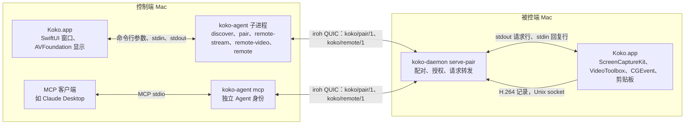

# Koko (叩叩) 技术架构与协议设计

[返回文档目录](./README.md)

本文分两部分。[当前实现](#当前实现macos-内测版)记录 macOS 内测版（0.1.x）实际运行的模块、协议和授权方式，以代码为准。[目标设计](#目标设计与后续规划)记录 MVP v0.1 的技术选型、四通道协议、MCP 工具集和**人机控制权仲裁器（Human-in-the-Loop Arbiter）**，其中尚未实现的部分在各节开头注明。首轮交付范围与验收顺序见 [Phase 1 实现计划](./implementation.md)。

## 当前实现（macOS 内测版）

### 进程与模块

macOS 内测版由一个 Swift 应用和包内的命令行辅助程序组成。界面、权限交互和所有 macOS 系统调用在 Swift 中完成。设备身份、配对、QUIC 传输和会话授权在 Rust 中完成。两者通过子进程的标准输入输出交换文本行，视频经被控端本机的 Unix socket 传递。



| 组件 | 位置 | 职责 |
| --- | --- | --- |
| `Koko.app` | `apps/koko-macos/` | SwiftUI 主窗口、远控窗口和设置。被控端执行 daemon 转发的桌面请求，包括显示器列表、截帧、视频推流、键鼠和剪贴板。控制端管理各个 `koko-agent` 子进程，解码显示视频，合并并发送键鼠事件。 |
| `koko-daemon` | `crates/koko-daemon` | 被控端监听进程。管理连接码、局域网请求、信任列表和当前会话授权，把已授权的远控命令转给 `Koko.app` 或 `koko-desktop`。 |
| `koko-agent` | `crates/koko-agent` | 控制端 CLI。负责发现、配对、单次命令、持续命令通道和视频订阅，应用和脚本使用同一个程序。`mcp` 子命令以 stdio 提供 MCP Server，见 [Agent 与 MCP 设计规范](./agent.md)。 |
| `koko-desktop` | `apps/koko-macos/desktop/` | 不经图形版、单独运行 daemon 时使用的 Swift 辅助程序，只处理主屏 PNG、比例坐标点击、常用按键和文本。 |
| `koko-proto` | `crates/koko-proto` | ALPN 常量、远控命令与回复类型、请求校验和大小上限。 |
| `koko-p2p` | `crates/koko-p2p` | 设备密钥持久化、iroh 端点、连接码、直连邀请、mDNS 发现和远控客户端。 |
| `koko-capture` | `crates/koko-capture` | macOS 录屏权限探测，供 `koko-daemon screen-permission` 在找不到 `koko-desktop` 时使用。 |
| `koko-input` | `crates/koko-input` | 空 crate，预留给后续跨平台键鼠实现。macOS 键鼠由 Swift 投递。 |

设备私钥是 32 字节文件，保存在 `~/.koko/host.key`、`~/.koko/controller.key` 和 Agent 默认使用的 `~/.koko/agent.key`。被控端的信任列表保存在 `~/.koko/trusted-controllers.json`，每条记录包含公钥、类型（`human` 或 `agent`）、作用域、名称和批准时间，仅图形版模式（`--app-desktop`）读写。0.1.20 及更早版本的 `trusted-controllers` 每行一个人类控制端公钥，daemon 启动时迁移为新格式并删除旧文件。Agent 的设备注册表与身份文件同目录，默认是 `~/.koko/agent-hosts.json`。

### 网络与 ALPN

所有端点使用 iroh 的 `presets::Minimal`，不使用中继或外部地址发现，只按 IP 直连。被控端监听显式指定的 IPv4 地址和端口，默认 `0.0.0.0:4444/UDP`。同一端点按 ALPN 区分三种协议：

| ALPN | 用途 |
| --- | --- |
| `koko/1` | 授权自检。控制端发送 `0x01`、四字节大端长度和 JSON 字符串 `"hello"`。已授权时主机以同样格式回复 `"ready"`。`koko-agent check` 使用这条路径。 |
| `koko/pair/1` | 配对。人类控制端在一条双向流上发送 10 字节连接码，或发送 `request` 申请局域网确认，批准后主机回复 `koko/1` 的 `ready` 帧。Agent 发送不超过 1 KiB 的 JSON（版本 2），声明类型、名称、申请的作用域和可选的连接码，批准后主机回复 `{"v":2,"scope":...}`。 |
| `koko/remote/1` | 远控。每条双向流承载一条 JSON 命令和一条 JSON 回复；视频订阅的流保持打开，持续传送二进制记录。 |

配对入口有三种格式：

- **连接码**：10 个字符，取自去掉易混字符的 32 字符表（约 50 位熵），显示为 `ABCDE-FGHJK`。控制端通过 mDNS 查找对应主机，再在加密连接内提交连接码。
- **直连邀请**：`koko://pair/v1/<连接码>/<主机公钥>/<IPv4:端口,...>`，用于组网环境中 mDNS 无法到达的情况。
- **局域网申请**：`koko://request/v1/<主机公钥>/<IPv4:端口,...>`，由 `koko-agent discover` 的 `request` 字段给出，需要被控端确认。

mDNS 服务类型为 `_koko-pair._udp.local.`。TXT 记录包含主机公钥 `id`、系统类型 `os`、可选的设备名 `name`（最长 54 个字符），以及 `proof`。`proof` 是 `blake3("koko/lan-pair/1" ‖ 主机公钥 ‖ 连接码)` 的十六进制值，控制端据此找到连接码对应的主机，连接码本身不在网络上广播。

### 会话授权

被控端同一时间最多授权一个人类控制端和一个 Agent，两者可以同时连接。daemon 在接受连接时和处理每条远控请求前，都按 QUIC 握手确认的公钥查出该连接的作用域。某个会话被撤销时，只有它自己的连接会关闭；正在等待桌面回复的请求和视频流也随之结束。

| 事件 | 结果 |
| --- | --- |
| 人类控制端提供有效连接码 | 直接授权。连接码有效期 5 分钟，任何一次批准后即失效。 |
| 已信任的人类控制端发来局域网申请 | 直接授权。 |
| Agent 首次配对 | 即使提供了有效连接码，也输出 `Pair request` 等待被控端确认。 |
| 已信任的 Agent 申请不高于已授予的作用域 | 直接授权，不再询问。 |
| 其他局域网申请，或 Agent 申请更高的作用域 | 输出 `Pair request` 等待确认。同时只保留一个待确认请求。 |
| 已有人类会话时，又有人类控制端申请 | 拒绝，控制端看到 `pairing declined or expired`。 |
| 已有 Agent 会话时，另一个 Agent 申请 | 拒绝，控制端看到 `agent_busy`。 |
| 控制端发送 `disconnect` | 只撤销该控制端自己的会话。 |
| 被控端断开 Agent | 只撤销 Agent 会话。 |
| 被控端清除信任或停止共享 | 撤销全部会话。 |

| 作用域 | 授予对象 | 允许的命令 |
| --- | --- | --- |
| `human` | 人类控制端 | 全部命令 |
| `observer` | Agent | `hello`、`displays`、`screenshot`、`capture`、`video`、`disconnect`。其他命令返回 `scope_denied`。 |
| `agent_safe` | Agent | `observer` 的命令，加上 `pointer`、`click`、`key`、`text` 和 `release_control`。输入还要经过控制权仲裁。剪贴板仍只对人类开放。 |

Agent 的输入由 daemon 的仲裁器（`crates/koko-daemon/src/arbiter.rs`）判定。控制权有三种状态：`idle` 时 Agent 的下一条输入取得控制权，3 秒内有过人类输入则拒绝；`active` 时 Agent 可以操作，人类控制端的键鼠或剪贴板请求、被控端的「停止」或 ⌃⌥⌘. 都会转为 `paused`；`paused` 时 Agent 的输入返回 `preempted_by_human`，直到被控端的人点「让 Agent 继续」。Agent 60 秒没有输入、发送 `release_control` 或会话结束时，控制权回到 `idle`。被 Agent 发出的每条请求会写入 `~/.koko/audit.log`，不含截图和文本内容。

「观看模式」只在控制端停止发送键鼠和剪贴板请求，被控端不区分人类会话的观看与控制。

### 远控命令

命令和回复都是带标签的 JSON，定义在 `koko-proto`。请求最大 128 KiB，回复最大 16 MiB，坐标按所选显示器归一化到 0–9999。

| `action` | 参数 | 成功回复 |
| --- | --- | --- |
| `hello` | 无 | `hello`，含本连接的 `kind`（`human` 或 `agent`）、`scope` 和控制权状态 `control` |
| `release_control` | 无 | `ok`，Agent 交还控制权 |
| `displays` | 无 | `displays`，含 `host_name`、显示器列表、`video`、`clipboard` 能力标记和控制权状态 `control` |
| `capture` | `display`、`edge`（320–4096）、`quality`（20–95），可选 `format`（`jpeg` 或 `png`）和 `cursor` | `image`，Base64 图像，以及 `width`、`height` 和 `format` |
| `video` | `capture` 的参数和 `fps`（30、60、90、120、144、165 或 240） | 二进制视频记录流 |
| `pointer` | `display`、1–32 个 `events`，可选 `source_os` | `ok` |
| `clipboard` | `transfer`（UUID）、`op`（`copy`、`begin`、`next`、`write`、`cancel`），`write` 时带 `packet` | `ok` 或 `clipboard` 数据包 |
| `screenshot` | 无 | `frame`，主屏 Base64 PNG |
| `click`、`key`、`text` | 主屏比例坐标、常用按键名或最长 2048 字节的文本 | `ok` |
| `disconnect` | 无 | `ok`，同时撤销本会话授权 |

`pointer` 事件包括 `move`、`down`、`up`、`scroll`、`key_down`、`key_up` 和 `release`。按键使用 Mac 虚拟键码与 Core Graphics 修饰位右移 16 位。daemon 同一时间只允许一条连接发送 `pointer`，另一条连接会收到 `pointer_busy`，以保证按下、拖动和抬起的顺序。视频订阅同样只允许一个，新的订阅在旧订阅结束前收到 `video_busy`。

失败时回复 `{"status":"error","code":...}`。稳定的错误码包括 `invalid_command`、`scope_denied`、`preempted_by_human`、`desktop_unavailable`、`screen_permission_required`、`input_permission_required`、`display_unavailable`、`capture_busy`、`capture_failed`、`input_failed`、`pointer_busy`、`video_busy` 和 `clipboard_*` 系列。桌面请求默认等待 9 秒，剪贴板请求因可能等待 macOS 文件访问确认而等待 120 秒。

以图形版模式运行时，所有命令都交给 `Koko.app`。单独运行 `koko-daemon serve-pair` 时，`screenshot`、`click`、`key` 和 `text` 由同目录的 `koko-desktop` 执行，其余命令返回 `desktop_unavailable`。

### 视频记录

视频流中的每条记录是四字节大端长度，后接一字节类型和载荷，长度包含类型字节，单条不超过 8 MiB。

| 类型 | 值 | 载荷 |
| --- | --- | --- |
| `format` | 1 | SPS 与 PPS，各自带四字节大端长度前缀。格式变化时重发。 |
| `frame` | 2 | 一帧 H.264，NAL 单元使用四字节长度前缀（AVCC）。 |
| `error` | 3 | UTF-8 错误码，随后视频流结束。 |
| `path` | 4 | 由控制端 `koko-agent` 每秒插入：八字节大端 RTT 毫秒数，加一字节是否为 IP 直连。 |

被控端 `Koko.app` 以所选帧率启动 ScreenCaptureKit，用 VideoToolbox 实时编码（关闭帧重排，最长两秒一个关键帧），把记录写入 daemon 创建的 Unix socket。socket 位于仅当前用户可访问（0700）的临时目录。daemon 将其原样复制到 QUIC 流。控制端用 `AVSampleBufferDisplayLayer` 显示，并按 `path` 记录中的 RTT 自动降低分辨率和画质。

### 应用与辅助进程的接口

被控端应用启动 `koko-daemon serve-pair ~/.koko/host.key 0.0.0.0:<端口> --app-desktop <设备名>`，按行读取其输出：

| daemon 输出 | 含义 |
| --- | --- |
| `Listening on <地址>`、`Trusted devices: <数量>` | 启动信息与信任设备数 |
| `Pair code: <码>`、`Pair invite: <邀请>`、`Pair code expired` | 连接码与直连邀请 |
| `Pair request: <编号> <公钥短标识> <JSON>` | 等待确认的申请，JSON 含 `kind`、`name` 和 `scope` |
| `Pair approved`、`Session closed` | 人类会话开始与结束 |
| `Agent session: <公钥短标识> <JSON>`、`Agent session closed` | Agent 会话开始与结束，JSON 含 `name` 和 `scope` |
| `Agent control: idle`、`active`、`paused` | Agent 控制权变化，应用据此显示屏幕顶部的指示条 |
| `Pair declined`、`Pair request ended`、`Pair code used` | 申请被拒绝、申请方已离开、连接码因批准而失效 |
| `Desktop request: <编号> <JSON>` | 需要应用执行的远控命令；视频命令附带 `video_socket` 路径 |
| `Pointer closed` | 键鼠连接结束，应用释放仍按下的键和鼠标按钮 |

应用向 daemon 写入 `approve <编号> [作用域]`、`remember <编号> [作用域]`、`decline <编号>`、`end-agent`、`stop-agent`、`resume-agent`、`forget-trusted` 或 `desktop-reply <编号> <JSON>`。作用域参数只能缩小 Agent 申请的范围。

控制端应用为不同用途分别启动 `koko-agent`：`discover` 和 `pair` 各运行一次；`remote-stream` 为画面与显示器、键鼠和剪贴板各保持一个进程，按行收发 JSON；`remote-video` 每次视频订阅一个进程，把视频记录写到标准输出；`remote` 用于单次的按键、文本和断开命令。

### 性能边界

控制端的每个辅助进程持有各自的 iroh 端点和连接。评估资源开销时，分别记录待机、开启共享、1080p/60 FPS 远控和断开后的进程数、内存、CPU 与接收帧率。编解码和帧缓冲应一并纳入测量。

可以先验证复用控制端的 Rust 进程是否降低内存和连接开销。若进一步复用为一条 QUIC 连接，需要并行处理视频和控制流，保持输入顺序，并验证撤销授权后各流及时关闭。若分析定位到 macOS 调用边界的复制或分配开销，再考虑收窄原生桥接层，继续使用系统采集、编解码与权限接口。

## 目标设计与后续规划

以下各节是 MVP v0.1 的目标设计。已在当前实现中落地或调整的部分，在各节开头说明。

## 1. MVP 技术栈定案

> 实现状态：iroh 已用于身份与传输，局域网发现另用 mDNS。macOS 采集、编码和键鼠已按下表的系统框架实现。桌面客户端由 Swift/SwiftUI 的 `Koko.app` 承担，未采用 Tauri。`koko-agent mcp` 已用 rmcp 提供 MCP，可截图与操作键鼠。Windows 与 Linux 尚无实现。

为避免在早期陷入 6 端适配与底层编解码泥潭，MVP 阶段锁定 **Desktop 优先（Windows / macOS / Linux）+ P2P 打洞 + 原生 MCP 桥接**，优先跑通“人类旁观 + AI 远程操控真实电脑 + 随时接管”的完整闭环。

| 层级 / 模块 | 推荐选型 | 核心理由 | 备选方案与取舍 |
| :--- | :--- | :--- | :--- |
| **P2P 传输与打洞 (`koko-p2p`)** | [iroh](https://github.com/n0-computer/iroh) | 纯 Rust 实现的 QUIC + NAT 穿透 + 中继回落；按公钥（`NodeId`）拨号，天然端到端加密；单条连接支持多路复用 Stream，完美同时承载视频流与 Agent RPC | WebRTC（适合浏览器直连，但信令复杂、DataChannel 承载结构化 RPC 较笨重，留待后续 Web 网关扩展） |
| **MCP 协议层 (`koko-agent`)** | [rmcp](https://github.com/modelcontextprotocol/rust-sdk) | 官方 Rust MCP SDK，支持 `#[tool]` 宏与 stdio / HTTP 传输，直接将远端设备暴露为 Claude / OpenAI / 本地模型的标准工具节点 | 自研 JSON-RPC（维护成本高，生态兼容性差） |
| **屏幕采集** | macOS 使用 [ScreenCaptureKit](https://developer.apple.com/documentation/screencapturekit) 和 [VideoToolbox](https://developer.apple.com/documentation/videotoolbox) | Koko.app 连续采集所选显示器。被控端通过当前用户私有的 Unix socket 将 H.264 送入已授权的 QUIC 视频流。控制端用 AVFoundation 显示。CLI 截图保持主屏 PNG | 其他平台可评估 [xcap](https://github.com/nashaofu/xcap)、[scap](https://github.com/CapSoftware/scap) 或原生方案 |
| **键鼠注入** | macOS 测试包使用 [Core Graphics](https://developer.apple.com/documentation/coregraphics/cgevent) | 画面与鼠标使用独立连接，按显示器映射坐标，顺序传递按钮与拖拽事件 | 其他平台可评估 [enigo](https://github.com/enigo-rs/enigo)，Wayland 支持按实际输入后端验证 |
| **桌面客户端 (`koko-client`)** | [Tauri v2](https://github.com/tauri-apps/tauri)（MVP 首选） | 研发效率高、包体小，极适合快速构建“设备列表 + 实时旁观画面 + Agent 操作日志/审批面板 + 一键接管悬浮条” | 若明确要第一时间做 iOS/Android 且追求零拷贝纹理渲染，改用 Flutter + [flutter_rust_bridge](https://github.com/fzyzcjy/flutter_rust_bridge)；若追求纯 Rust 极简分发可选 [Slint](https://github.com/slint-ui/slint) |

## 2. 系统总体架构（Human + Agent 双模拓扑）

> 实现状态：下图是目标拓扑。MCP Server 与被控端的控制权仲裁已实现；`koko-client` 和四通道尚未实现，高危审批尚未实现。当前拓扑见[进程与模块](#进程与模块)。

Koko 的核心思想是**“一套 P2P 加密通道，同时服务人类视觉与 AI 工具调用”**。本地侧（Controller）运行极简 MCP Server 与旁观 UI；远端侧（Host）运行 `koko-daemon`，负责采集、注入与权限仲裁。


## 3. `koko-p2p` 多路复用协议设计

> 实现状态：当前使用 `koko/1`、`koko/pair/1` 和 `koko/remote/1` 三个 ALPN，见[网络与 ALPN](#网络与-alpn)。会话区分人类与 Agent，作用域已有 `human`、`observer` 和 `agent_safe`，尚无 `lease_id`。下文的统一 ALPN 与四通道是后续设计。Agent 身份、作用域和租约在现有 `koko/remote/1` 上的扩展方式见 [Agent 与 MCP 设计规范](./agent.md#协议变更)。

基于 [iroh](https://github.com/n0-computer/iroh) 的 QUIC 连接，定义统一 ALPN：`koko/1`。所有流量天然受 TLS 1.3 + Ed25519 设备公钥身份保护，无需额外搭建复杂的账号中心即可完成设备互信。

### 3.1 身份与分级授权模型

每台主机启动 `koko-daemon` 时生成持久化密钥对，公开标识为其 `NodeId`。主人在远端授权时可签发不同权限作用域（Capability Scope）的配对凭证：

| 权限级别 | 允许的操作 | 典型场景 |
| :--- | :--- | :--- |
| `Observer` | 仅拉取视频流、按需截图、读取只读 UI 树 | 手机端纯旁观、AI 仅做屏幕诊断 |
| `AgentSafe` | 截图、读取 UI 树、在允许区域内点击/输入；高危操作需人工点击确认 | 日常让 AI 整理文件、操作浏览器、跑常规任务 |
| `AgentFull` | 完整键鼠注入 + 受控 Shell / 文件传输（仍受人类随时抢占约束） | 无人值守跑脚本、视频渲染、自动化测试 |
| `HumanAdmin` | 最高优先级，随时抢占控制权、踢出 Agent 会话、修改策略 | 主人本人远程操作与应急接管 |

### 3.2 四通道 Stream 规划

在单条 QUIC 连接内按业务语义隔离四个通道，避免大体积视频帧阻塞键鼠或紧急暂停指令：

| 通道标识 | QUIC 形态 | 帧格式 | 职责说明 |
| :--- | :--- | :--- | :--- |
| **0x01 Control** | 双向可靠 Stream | Length-Prefixed CBOR / JSON | 握手鉴权、能力协商、心跳、**控制权切换事件**、高危审批弹窗回调、紧急急停（Kill-Switch） |
| **0x02 Media** | 单向 Stream 或 QUIC Datagram | 自定义帧头 + H.264 NAL 单元或 AV1 OBU | 面向人类旁观的低延迟音视频流；支持丢帧追赶，减少视频传输对控制指令的影响 |
| **0x03 Input** | 双向可靠 Stream | Compact Binary / CBOR | 标准化键鼠与剪贴板事件，每条事件携带 `actor: Human \| Agent` 与 `lease_id` |
| **0x04 Agent RPC** | 双向可靠 Stream | Length-Prefixed JSON-RPC 2.0 | 承载 `koko-agent` 发往远端的按需抓帧（PNG/WebP + 坐标缩放元数据）、UI 树查询、受控命令执行 |

当前的 `koko/1` 自检帧格式沿用上表 Control 通道的帧头。配对、远控命令与视频记录的现行格式见[当前实现](#当前实现macos-内测版)。迁移到统一连接时，需要保持输入顺序，并在撤销授权后及时关闭各通道。

## 4. `koko-agent`（MCP 工具集）与人机协同仲裁

> 实现状态：M1 与 M2 已实现：Agent 身份、首次确认与信任重连、`observer` 与 `agent_safe` 作用域、控制权仲裁与人工抢占、被控端指示条和审计日志，以及 `koko_list_devices`、`koko_pair`、`koko_screenshot`、`koko_mouse`、`koko_keyboard`、`koko_release_control`。人工求助、本机实体输入检测和界面树尚未实现。

完整设计见 [Agent 与 MCP 设计规范](./agent.md)，包括 Agent 身份与配对、作用域、控制权状态机、截图坐标映射、键名规范、MCP 工具、协议扩展和里程碑。要点如下：

- `koko-agent mcp` 在控制端以 stdio 提供 MCP，使用独立的 Agent 密钥直连被控端。被控端依据公钥识别 Agent，作用域、租约和抢占都在 daemon 判定。
- 被控端同时允许一个人类会话和一个 Agent 会话，人可以看着 Agent 操作。人的输入或被控端的「停止」会吊销 Agent 的租约，后续请求返回 `preempted_by_human`。
- MCP 工具包括 `koko_list_devices`、`koko_pair`、`koko_screenshot`、`koko_mouse`、`koko_keyboard`、`koko_request_human`、`koko_release_control`，界面树 `koko_get_ui_tree` 安排在 Phase 3。
- 高危操作审批（`ApprovalPending`）安排在策略阶段，本阶段先保证作用域、人工接管和审计。

## 5. Rust Workspace 目录与分阶段落地计划

### 5.1 精简后的 Workspace 结构

当前仓库结构如下。各 crate 的实际职责见[进程与模块](#进程与模块)。

```text
koko/
├── Cargo.toml
├── apps/koko-macos/     # Koko.app（Swift/SwiftUI）与 desktop/ 下的 koko-desktop 辅助程序
├── crates/
│   ├── koko-proto/      # ALPN、远控命令与回复、请求校验
│   ├── koko-p2p/        # 设备身份、iroh 端点、配对、mDNS 发现、远控客户端
│   ├── koko-capture/    # macOS 录屏权限探测
│   ├── koko-input/      # 预留，暂无代码
│   ├── koko-daemon/     # 被控端配对、授权与请求转发
│   └── koko-agent/      # 控制端 CLI
├── scripts/             # macOS 构建、打包、更新附件与桌面回归测试
└── tests/macos/         # Swift 回归测试
```

下面是 MVP 规划的目标结构。`koko-client` 的职责目前由 `apps/koko-macos` 承担。

```text
koko/
├── Cargo.toml
└── crates/
    ├── koko-proto/      # 共享协议定义、消息帧、权限模型、Arbiter 状态
    ├── koko-p2p/        # 基于 iroh 的连接管理、设备配对、四通道封装
    ├── koko-capture/    # 基于 xcap/scap 的按需抓帧与视频流采集
    ├── koko-input/      # 基于 enigo 的跨平台键鼠注入与坐标归一化
    ├── koko-daemon/     # 远端常驻守护进程（含 Arbiter 仲裁器与策略引擎）
    ├── koko-agent/      # 本地 MCP Server (rmcp) + CLI
    └── koko-client/     # 桌面端 UI (Tauri v2)：旁观画面、审批弹窗、一键接管
```

### 5.2 务实的四阶段里程碑

> 实现状态：当前处于 Phase 1。人工远控已经先于 Agent 闭环落地，包括 Phase 2 中的连续视频和远程键鼠。MCP、Agent 键鼠与人工抢占已实现；人工求助、NAT 穿透与中继尚未实现。逐项进度见 [Phase 1 实现计划](./implementation.md#实现顺序与验收)。

| 阶段 | 核心目标 | 验收标准（可演示 Demo） |
| :--- | :--- | :--- |
| **Phase 1: Headless Agent Loop** | 跑通 `koko-proto` + `koko-p2p` + `koko-daemon` + `koko-agent` | Claude Desktop 通过本地 MCP 配置，跨越 NAT 穿透连接到家里电脑，完成截图与键鼠点击 |
| **Phase 2: Watch & Takeover** | 引入 `koko-client`（Tauri v2）与 `Media` 通道 + Arbiter 抢占 | 主人实时看到 AI 在远端电脑的操作画面，鼠标一动立即抢占接管，AI 自动暂停 |
| **Phase 3: UI Tree & Policy** | 补齐三端 UI Accessibility Tree、高危审批卡片、硬件编解码优化 | AI 结合 UI 树与按需截图精准操控复杂应用；敏感操作触发客户端弹窗确认 |
| **Phase 4: Mobile & Self-Host** | 移动端旁观/审批客户端（iOS/Android）与自建中继文档 | 手机随时看进度、点同意、或应急接管 |

## 6. 跨平台工程避坑清单

- **macOS 权限引导**在被控端用户启用对应功能时触发。画面需要本次会话授权和系统录屏许可，远程键鼠需要辅助功能许可，剪贴板文件可能触发「文件与文件夹」确认。[macOS 权限设计](./macos-permissions.md)
- **Windows DPI 与 UAC**：高分屏缩放会导致截图坐标与物理像素错位，必须在 `koko_screenshot` 返回值中携带逻辑/物理尺寸与显示器原点偏移；涉及管理员权限窗口时，普通用户态进程无法注入输入，需预留 Windows Service 模式。
- **Linux Wayland 兼容**：Wayland 出于安全隔离限制直接截屏与输入注入，MVP 阶段建议明确优先支持 X11，Wayland 下通过 `xdg-desktop-portal` 逐步适配。
