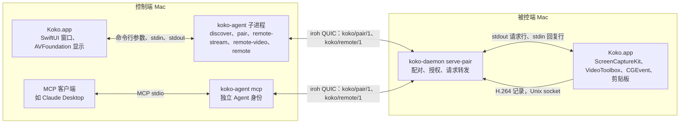
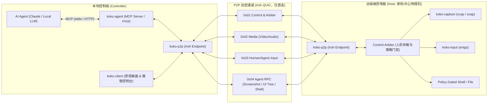

# Koko (叩叩) 技术架构与协议设计

[返回文档目录](./README.md)

本文分两部分。[当前实现](#当前实现macos-内测版)记录 macOS 内测版（0.1.x）实际运行的模块、协议和授权方式，以代码为准。[目标设计](#目标设计与后续规划)记录 MVP v0.1 的技术选型、四通道协议、MCP 工具集和**人机控制权仲裁器（Human-in-the-Loop Arbiter）**，其中尚未实现的部分在各节开头注明。首轮交付范围与验收顺序见 [Phase 1 实现计划](./implementation.md)。

## 当前实现（macOS 内测版）

### 进程与模块

macOS 内测版由一个 Swift 应用和包内的命令行辅助程序组成。界面、权限交互和所有 macOS 系统调用在 Swift 中完成。设备身份、配对、QUIC 传输和会话授权在 Rust 中完成。两者通过子进程的标准输入输出交换文本行，视频经被控端本机的 Unix socket 传递。



| 组件 | 位置 | 职责 |
| --- | --- | --- |
| `Koko.app` | `apps/koko-macos/` | SwiftUI 主窗口、远控窗口和设置。被控端执行 daemon 转发的桌面请求，包括显示器列表、截帧、视频推流、键鼠和剪贴板。控制端管理各个 `koko-agent` 子进程，解码显示视频，合并并发送键鼠事件。 |
| `koko-daemon` | `crates/koko-daemon` | 被控端监听进程。管理设备 ID、验证码、局域网请求、信任列表和当前会话授权，把已授权的远控命令转给 `Koko.app` 或 `koko-desktop`。 |
| `koko-agent` | `crates/koko-agent` | 控制端 CLI。负责发现、配对、单次命令、持续命令通道和视频订阅，应用和脚本使用同一个程序。`mcp` 子命令以 stdio 提供 MCP Server，见 [Agent 与 MCP 设计规范](./agent.md)。 |
| `koko-desktop` | `apps/koko-macos/desktop/` | 不经图形版、单独运行 daemon 时使用的 Swift 辅助程序，只处理主屏 PNG、比例坐标点击、常用按键和文本。 |
| `koko-proto` | `crates/koko-proto` | ALPN 常量、远控命令与回复类型、请求校验和大小上限。 |
| `koko-p2p` | `crates/koko-p2p` | 设备密钥持久化、iroh 端点、设备 ID、验证码证明、直连邀请、mDNS 发现和远控客户端。 |
| `koko-capture` | `crates/koko-capture` | macOS 录屏权限探测，供 `koko-daemon screen-permission` 在找不到 `koko-desktop` 时使用。 |
| `koko-input` | `crates/koko-input` | 空 crate，预留给后续跨平台键鼠实现。macOS 键鼠由 Swift 投递。 |

设备私钥是 32 字节文件，保存在 `~/.koko/host.key`、`~/.koko/controller.key` 和 Agent 默认使用的 `~/.koko/agent.key`。被控端的信任列表保存在 `~/.koko/trusted-controllers.json`，每条记录包含公钥、类型（`human` 或 `agent`）、作用域、名称和批准时间，仅图形版模式（`--app-desktop`）读写。0.1.20 及更早版本的 `trusted-controllers` 每行一个人类控制端公钥，daemon 启动时迁移为新格式并删除旧文件。Agent 的设备注册表与身份文件同目录，默认是 `~/.koko/agent-hosts.json`。

### 网络与 ALPN

所有端点使用 iroh 的 `presets::Minimal`，不使用中继或外部地址发现，只按 IP 直连。被控端监听显式指定的 IPv4 地址和端口，默认 `0.0.0.0:27688/UDP`（端口被占用时自动顺延到可用端口）。同一端点按 ALPN 区分三种协议：

| ALPN | 用途 |
| --- | --- |
| `koko/1` | 授权自检。控制端发送 `0x01`、四字节大端长度和 JSON 字符串 `"hello"`。已授权时主机以同样格式回复 `"ready"`。`koko-agent check` 使用这条路径。 |
| `koko/pair/1` | 配对。控制端发送不超过 1 KiB 的 JSON（版本 3），声明类型、名称、申请的作用域、可选的验证码证明 `proof` 和 `quiet`，批准后主机回复 `{"v":3,"scope":...}`。旧客户端只发 `request` 时仍可申请被控端确认；明文验证码一律拒绝。 |
| `koko/remote/1` | 远控。每条双向流承载一条 JSON 命令和一条 JSON 回复；视频订阅的流保持打开，持续传送二进制记录。 |

配对入口有三种格式：

- **设备 ID + 验证码**：设备 ID 是 9 位数字，由 `blake3("koko/device-id/1" ‖ 主机公钥)` 得出，永不变化。控制端通过 mDNS 找到设备 ID 对应的主机。验证码是 6–16 位 ASCII 字母或数字，不区分大小写；临时验证码为 8 位，取自去掉易混字符的 32 字符表。
- **直连邀请**：`koko://pair/v1/<验证码>/<主机公钥>/<IPv4:端口,...>`，用于组网环境中 mDNS 无法到达的情况。
- **局域网申请**：`koko://request/v1/<主机公钥>/<IPv4:端口,...>`，由 `koko-agent discover` 的 `request` 字段给出，需要被控端确认。

mDNS 服务类型为 `_koko-pair._udp.local.`。TXT 记录包含主机公钥 `id`、系统类型 `os` 和可选的设备名 `name`（最长 54 个字符）。

验证码从不在网络上传输。控制端发送 `proof = blake3_keyed(derive_key("koko/pair-proof/1", 验证码), 主机公钥 ‖ 控制端公钥)` 的十六进制值，主机用自己的公钥和 QUIC 握手确认的控制端公钥重新计算并比对。冒充主机的设备只能拿到绑定它自己公钥的证明，无法拿去连接真正的主机。

设备 ID 只有约 30 位，有人可以刻意生成设备 ID 相同的密钥。因此控制端连接过某台主机后，会记住它的公钥（应用传 `--known`，MCP 读取已配对设备列表），之后按设备 ID 查找时只接受公钥一致的主机。首次连接仍依赖局域网可信，需要更高保证时改用直连邀请。

配对版本不一致时，主机以 `pair_version_mismatch` 关闭连接；更早的主机回复 `invalid pairing request`。控制端把两者都提示为「两端版本不一致」。

主机统计所有控制端输错验证码的次数：连续 5 次后暂停校验验证码 30 秒，之后每错一次时长翻倍，最长 10 分钟，期间回复 `too_many_attempts`。验证成功后清零。已信任的控制端不需要验证码，不受影响。

### 会话授权

被控端同一时间最多授权一个人类控制端和一个 Agent，两者可以同时连接。daemon 在接受连接时和处理每条远控请求前，都按 QUIC 握手确认的公钥查出该连接的作用域。某个会话被撤销时，只有它自己的连接会关闭；正在等待桌面回复的请求和视频流也随之结束。

| 事件 | 结果 |
| --- | --- |
| 人类控制端提供有效验证码证明 | 直接授权。临时验证码在人类会话结束时刷新；会话进行中其他人类控制端会被拒绝，因此每次会话只能用一次。自定义验证码不过期，至少 8 位且须同时包含字母和数字。 |
| 已信任的人类控制端发来局域网申请 | 直接授权。 |
| Agent 首次配对 | 即使提供了有效验证码，也输出 `Pair request` 等待被控端确认。 |
| 已信任的 Agent 申请不高于已授予的作用域 | 直接授权，不再询问。 |
| 其他局域网申请，或 Agent 申请更高的作用域 | 输出 `Pair request` 等待确认。同时只保留一个待确认请求。 |
| 已有人类会话时，又有人类控制端申请 | 拒绝，控制端看到 `pairing declined or expired`。 |
| 已有 Agent 会话时，另一个 Agent 申请 | 拒绝，控制端看到 `agent_busy`。 |
| 控制端发送 `disconnect` | 只撤销该控制端自己的会话。 |
| 被控端断开 Agent | 只撤销 Agent 会话。 |
| 被控端清除信任或停止共享 | 撤销全部会话。 |

| 作用域 | 授予对象 | 允许的命令 |
| --- | --- | --- |
| `human` | 人类控制端 | 全部命令 |
| `observer` | Agent | `hello`、`displays`、`ui_tree`、`screenshot`、`capture`、`video`、`audio`、`disconnect`。其他命令返回 `scope_denied`。 |
| `agent_safe` | Agent | `observer` 的命令，加上 `pointer`、`click`、`key`、`text` 和 `release_control`。输入还要经过控制权仲裁。剪贴板仍只对人类开放。 |

Agent 的输入由 daemon 的仲裁器（`crates/koko-daemon/src/arbiter.rs`）判定。控制权有五种状态：`idle` 时 Agent 的下一条输入取得控制权，3 秒内有过人类输入则拒绝；`active` 时 Agent 可以操作，人类控制端的键鼠或剪贴板请求、被控端的「停止」或 ⌃⌥⌘. 都会转为 `paused`；`paused` 时 Agent 的输入返回 `preempted_by_human`，直到被控端的人点「让 Agent 继续」；`awaiting_human` 时 Agent 发出的 `request_human` 正在等人回答，Agent 的输入返回 `awaiting_human`，人回答「已完成」或超时后回到 `active`，回答「我来接管」「拒绝」或点「停止」后转为 `paused`；`awaiting_approval` 时一条 Agent 输入命中了被控端应用的高危操作规则，正等人「允许一次」「本次会话都允许」或「拒绝」，决定后回到 `active`，2 分钟无人回应按拒绝处理。规则见 [Agent 与 MCP 设计规范](./agent.md#高危操作审批)。被控 Mac 本机的实体键鼠由应用检测后以 `local-input` 告知 daemon，效果等同人类控制端的输入。Agent 60 秒没有输入、发送 `release_control` 或会话结束时，控制权回到 `idle`。Agent 发出的每条请求会写入 `~/.koko/audit.log`，不含截图和输入的文本。

「观看模式」只在控制端停止发送键鼠和剪贴板请求，被控端不区分人类会话的观看与控制。

### 远控命令

命令和回复都是带标签的 JSON，定义在 `koko-proto`。请求头最大 4 MiB，回复最大 16 MiB，坐标按所选显示器归一化到 0–9999。

| `action` | 参数 | 成功回复 |
| --- | --- | --- |
| `hello` | 无 | `hello`，含本连接的 `kind`（`human` 或 `agent`）、`scope` 和控制权状态 `control` |
| `release_control` | 无 | `ok`，Agent 交还控制权 |
| `ui_tree` | `max_nodes`（1–1000） | `ui_tree`，含前台应用名 `app`、展平的界面元素列表 `nodes` 和是否截断 `truncated`；元素边框按所在显示器归一化到 0–9999，密码框不含值 |
| `request_human` | `reason`（最多 500 字符）、`timeout_s`（10–600） | `human`，含 `result`（`resolved`、`declined`、`taken_over` 或 `timeout`）和可选的 `note`；等人回答期间保持请求打开 |
| `displays` | 无 | `displays`，含 `host_name`、显示器列表、`video`、`clipboard`、`clipboard_stream` 能力标记和控制权状态 `control` |
| `capture` | `display`、`edge`（320–4096）、`quality`（20–95），可选 `format`（`jpeg` 或 `png`）和 `cursor` | `image`，Base64 图像，以及 `width`、`height` 和 `format` |
| `video` | `display`、`edge`、`quality`、`fps`（30、60、90、120、144、165 或 240），可选 `audio`、`hevc`、`chroma444` 和 `feedback` | 二进制视频记录流；`feedback` 为真时请求头以换行结束，控制端在同一条流上回写反馈记录 |
| `audio` | 无 | 二进制音频记录流（与 `video` 共享同一条 QUIC 连接上的独立双向流，避免关键帧队头阻塞音频） |
| `pointer` | `display`、1–32 个 `events`，可选 `source_os` | `ok` |
| `clipboard_pull` | `transfer`（UUID） | 被控端按下 ⌘C 后，流上先发一条清单记录（文字，或文件与文件夹的相对路径和大小），再按清单顺序连续发送全部文件字节；出错时发错误记录 |
| `outbox_wait` | 无 | 最多等待 25 秒，返回被控端待发送的文件批次 `outbox`（`offers` 含批次 ID 和顶层名称）；有新批次时立即返回，超时返回空列表 |
| `outbox_pull` | `offer`（批次 ID） | 与 `clipboard_pull` 相同的流：清单记录后连续发送文件字节；每个批次只能拉取一次，已被拉走或已失效时发 `outbox_gone` 错误记录 |
| `clipboard_push` | `transfer`、`manifest`（同上的清单） | 请求头之后按清单顺序连续发送全部文件字节；被控端写入新建的接收目录后放入剪贴板并按 ⌘V，回复 `ok` |
| `screenshot` | 无 | `frame`，主屏 Base64 PNG |
| `click`、`key`、`text` | 主屏比例坐标、常用按键名或最长 2048 字节的文本 | `ok` |
| `disconnect` | 无 | `ok`，同时撤销本会话授权 |

`pointer` 事件包括 `move`、`down`、`up`、`scroll`、`key_down`、`key_up` 和 `release`。按键使用 Mac 虚拟键码与 Core Graphics 修饰位右移 16 位。daemon 同一时间只允许一条连接发送 `pointer`，另一条连接会收到 `pointer_busy`，以保证按下、拖动和抬起的顺序。视频和声音订阅各只允许一个。同一控制端发来新的订阅（例如切换显示器或调整画质）时，daemon 立即结束它的旧订阅并移交，最多等待 2 秒；其他控制端的订阅在旧订阅结束前收到 `video_busy` 或 `audio_busy`。

失败时回复 `{"status":"error","code":...}`。稳定的错误码包括 `invalid_command`、`scope_denied`、`preempted_by_human`、`awaiting_human`、`awaiting_approval`、`approval_declined`、`approval_timeout`、`desktop_unavailable`、`screen_permission_required`、`input_permission_required`、`display_unavailable`、`capture_busy`、`capture_failed`、`input_failed`、`pointer_busy`、`video_busy` 和 `clipboard_*` 系列。桌面请求默认等待 9 秒，剪贴板相关的桌面请求因可能等待 macOS 文件访问确认而等待 120 秒。

剪贴板文件在 Rust 中流式传输（`crates/koko-p2p/src/clipboard.rs`）：一次复制或粘贴只用一条 QUIC 流，不再按块往返，也不做 Base64 编码，速度取决于网络和磁盘。请求头以换行结尾，之后是正文；没有正文的请求仍可像以前一样直接结束发送。清单中的路径必须是相对路径，不能含 `.`、`..` 或空段；接收方只在新建的目录中创建文件，字节数与清单不符时整次传输作废。文件夹中的符号链接和特殊文件会被跳过，选中的符号链接本身会被拒绝。被控端的应用只负责按 ⌘C / ⌘V、提供文件路径和接收目录，文件内容由 daemon 读写；控制端由 `koko-agent clipboard-pull` / `clipboard-push` 读写文件，并按行输出进度。

各平台在请求入口通过 `koko_proto::safe_relative_path` 校验清单路径。路径含 NUL，使用 `.`、`..` 或空段，或以 `/` 开头时，请求返回 `invalid_command`。Windows 接收方在写入前进一步检查通过协议校验的整份文件清单，并确认拼接后的路径均位于接收目录内。路径段不能含反斜杠、冒号、`<>"|?*` 或其余控制字符，不能以点或空格结尾，也不能使用 Windows 保留设备名及其带扩展名形式。Windows 接收检查失败时，整批不写入，并返回 `clipboard_invalid`。

以图形版模式运行时，所有命令都交给 `Koko.app`。单独运行 `koko-daemon serve-pair` 时，`screenshot`、`click`、`key` 和 `text` 由同目录的 `koko-desktop` 执行，其余命令返回 `desktop_unavailable`。

### 音视频记录

视频流与音频流中的每条记录是四字节大端长度，后接一字节类型和载荷，长度包含类型字节，单条不超过 8 MiB。

| 类型 | 值 | 载荷 |
| --- | --- | --- |
| `format` | 1 | H.264 的 SPS 与 PPS，各自带四字节大端长度前缀。格式变化时重发。 |
| `frame` | 2 | 一帧 H.264 或 HEVC，NAL 单元使用四字节长度前缀（AVCC / HVCC）。 |
| `error` | 3 | UTF-8 错误码，随后流结束。 |
| `path` | 4 | 由控制端 `koko-agent` 每秒插入：八字节大端 RTT 毫秒数，加一字节是否为 IP 直连。 |
| `audioFormat` | 5 | 14 字节固定头：`u32be formatID`、`u32be sampleRate`、`u16be channels`、`u32be framesPerPacket`，随后是非空 Magic Cookie，直至记录末尾，无独立 cookie 长度。 |
| `audioFrame` | 6 | `u32be sequence`，随后是原始 AAC 数据；通常每条记录一个压缩包，若编码器未提供包描述，则整块非空压缩缓冲区写成一条记录。KoKo 不添加 ADTS、PTS 或时长。序号从 0 开始，按 2³² 回绕。 |
| `syncFrame` | 7 | 有符号 `i64be ptsUs`（二进制补码），随后是四字节长度前缀 NAL 单元。历史发送端相对初始采集主机时钟换算并四舍五入到微秒；当前版本不再发送，Windows 端不实现发送。历史接收兼容仍保留。 |
| `hevcFormat` | 8 | `u32be` 参数集数量，随后每个参数集为 `u32be` 长度和参数集字节（通常 VPS、SPS、PPS）。 |
| `streamInfo` | 10 | JSON：首条含被控端编码器（`hardware` / `software`）、采集方式（`ScreenCaptureKit`）和起始码率，在第一帧之前；之后码率每次调整再发一条只含 `bitrate`。只发给请求了 `feedback` 的控制端。 |
| `sequencedFrame` | 9 | 四字节大端帧序号、一字节标志（第 0 位为关键帧），后接与 `frame` 相同的载荷。只发给请求了 `feedback` 的控制端。 |

Windows daemon 为每次音频或视频请求创建独立的双向字节管道 `\\.\pipe\koko-video-<随机 GUID>`。创建时要求首个实例、仅一个实例、拒绝远程客户端。所有者与 DACL 唯一允许项均为 daemon 进程令牌的用户 SID。应用通过原有 `video_socket` 字段连接，向管道写媒体记录，从同一管道读视频反馈。

验证跨用户隔离时，在 Windows 上用账号 A 调试 daemon 的 `media_app_relays_video_feedback_and_independent_audio_over_quic` 测试。在模拟应用读取 `video_socket` 后、打开管道前设置断点并暂停进程。用现有普通账号 B 在同一台机器上打开 PowerShell，把下面的名字替换为断点处的管道名（去掉 `\\.\pipe\` 前缀），逐项连接。三次均应得到「拒绝访问」；超时或找不到管道不能证明隔离。此时在账号 A 的 PowerShell 中对同一管道调用一次 InOut 连接，应成功。结束调试，去掉断点后重跑该测试以验证双向传输；测试中的超时会计入断点暂停时间。

```powershell
foreach ($direction in 'In', 'Out', 'InOut') {
    $pipe = [IO.Pipes.NamedPipeClientStream]::new('.', 'koko-video-<GUID>', $direction)
    try {
        $pipe.Connect(2000)
        throw "Unexpected connection ($direction)"
    } catch [UnauthorizedAccessException] {
        "Access denied ($direction)"
    } finally {
        $pipe.Dispose()
    }
}
```

上述布局依据 `apps/koko-macos/AudioSync.swift` 的 `AudioPacketCodec`、`VideoStream.swift` 的 `VideoStreamRecord` / 编码器与 `LocalConnection.swift` 的接收分支核对（源码基线 `8b10240`）。此前文档中的 40 字节音频头、无序号音频包与缺少数量前缀的 HEVC 头均与该源码不符，此处按当前实现记录；没有借此修改线上的格式。类型 7 的发送布局来自历史提交 `9a20fec`，发送器在 `ff0cd1a` 被移除；当前接收器跳过前 8 字节，不使用其时间戳。

当前 macOS 音频为 48,000 Hz 双声道，优先 AAC-ELD（`formatID=0x61616365`，FourCC `aace`，480 采样/包，即 10 ms），失败回退 AAC-LC（`0x61616320`，FourCC `aac `，1024 采样/包，约 21.33 ms）。发送端首次取得非空 cookie 时发送一次类型 5，排在该次编码产生的类型 6 之前。类型 6 的发送本身不等待 cookie。解码器跳过类型 6 的四字节序号，把余下字节作为一个压缩包解码。

`remote-video` 的 `audio:true` 让辅助进程额外打开独立 `audio` 请求；主机视频采集本身仍禁用音频。音频请求不携带显示器 ID，macOS 为 ScreenCaptureKit 过滤器选择主屏或首个可用屏。辅助进程把两个流的完整记录合并到 stdout，不按跨流时间戳重排；音频流类型 3 错误只结束音频读取，不混入 stdout。当前视频发送类型 2 或 9，不能以缺少类型 7 判断采集失败。实机样例的采集与校验见[协议样例采集](./protocol-capture.md)，本轮尚未生成样例文件。

### 视频反馈与流控

请求带 `feedback` 的控制端在视频流的发送方向回写反馈记录，格式与视频记录相同（四字节大端长度含类型字节，再接类型和载荷）：

| 类型 | 值 | 长度 | 载荷 |
| --- | --- | --- | --- |
| `ack` | 1 | 5 | 四字节大端帧序号：控制端 `koko-agent` 收到并交给应用队列的最新一帧 |
| `keyFrame` | 2 | 1 | 无：控制端跳过了一帧，需要关键帧才能继续解码 |

确认由控制端 `koko-agent` 在收到帧、放入发往应用的队列（16 条）后立即发出，测量的是网络和辅助进程，不受应用主线程繁忙的影响；应用跟不上时队列写满，`koko-agent` 停止读取，确认随之停止，背压仍然传回被控端。`keyFrame` 由应用写入 `koko-agent` 的标准输入，只转发完整、合法的记录，排不上队时丢弃。被控端 daemon 再次校验后写入视频 Unix socket，遇到第一条不合法的记录即停止转发，视频本身不受影响。

被控端应用按反馈做三件事，状态在 `VideoFlow` 中：

1. **在途帧窗口**。只有未确认的帧少于「最快往返时间 + 两个帧间隔」对应的帧数再加一帧时，才采集并编码下一帧；局域网 60 FPS 下约 3–4 帧。跳过的帧从未编码，控制端的预测链不会断，网络变慢时只是帧率下降，画面不会因排队而越来越滞后。被拦下的最新一帧会保留，收到确认后补发，避免画面静止时控制端停在旧画面；补发的帧若比已发出的更旧则丢弃。两秒内从未收到确认的控制端视为不支持反馈，不再限流。
2. **码率自适应**。每帧的「发送到确认」耗时减去十秒内的最快一次，平滑后即排队延迟。每 0.25 秒评估一次，排队延迟超过 30 ms（或三个帧间隔）或期间至少三帧被窗口拦下记为拥塞；连续两次（约半秒）拥塞才把码率降到 85%，最低为起始码率的 25%，单个大帧或短暂卡顿不会降码率。一秒无拥塞后每半秒回升 15%，不超过起始码率；画面静止一秒以上后的第一帧直接恢复起始码率，避免静态画面因为几乎没有确认而一直停在低码率。新码率在下一帧前写入 VideoToolbox 会话，不重建编码器，并以 `streamInfo` 记录告知控制端，显示在网络面板的「目标码率」中。
3. **关键帧**。收到 `keyFrame` 后下一帧强制编码为关键帧，半秒内的重复请求合并。有反馈时周期关键帧放宽到最长十秒一个，减少周期性的码率尖峰；无反馈的旧控制端仍为两秒。

控制端收到 `sequencedFrame` 后总是回确认。显示层排不下时跳过该帧并请求关键帧，之后的非关键帧一律跳过，直到关键帧到达，避免花屏。

被控端 `Koko.app` 以所选帧率启动 ScreenCaptureKit。ScreenCaptureKit 会丢弃早于 `minimumFrameInterval` 到达的帧，若恰好设为目标帧间隔，显示器的时间抖动会让 60 FPS 只剩约 50 FPS；因此采集间隔设为目标的一半、`queueDepth` 为 5，再由应用按目标帧间隔的 75% 过滤，既不丢帧，也能把高刷新率屏幕降到目标帧率。视频用 VideoToolbox 实时硬件编码（Apple Silicon 优先协商 `HEVC Main 4:4:4 FullRange` + sRGB/Rec.709，自动回退 `HEVC Main 4:2:0 FullRange` 或 `H.264 High FullRange`，关闭帧重排，最长两秒一个关键帧，带反馈时十秒）；音频切分为精确 480 采样（10ms）送入 `AAC-ELD` 编码。视频与音频分别写入 daemon 在 0700 临时目录创建的两个 Unix socket（`v` 与 `a`），并由同一条 QUIC 连接上的两条独立双向流并发转发，避免大体积关键帧队头阻塞音频包。控制端在专用队列上用 VideoToolbox（`VTDecompressionSession`，优先硬件解码）逐帧解码出 IOSurface 像素缓冲，经 `CVMetalTextureCache` 零拷贝映射为 Metal 纹理，由着色器按 Rec.709（或 601）与全范围（或视频范围）转换为 sRGB，等比绘制到 `CAMetalLayer` 并立即呈现，不经过显示层自己的时钟和队列。每一帧都解码以保持预测链；显示器还在处理上一次绘制时，新帧只替换待画内容，最多两次绘制在途，因此在 60、120 或 165 Hz 屏幕上都跟随最新一帧。解码失败（缺少参考帧、睡眠后会话失效）时请求关键帧，而不是重启视频流。并用独立的低延迟 `AVAudioEngine` 播放声音，同时按 `path` 记录中的 RTT 自适应调整自动分辨率和画质；码率与帧率的实时调整见[视频反馈与流控](#视频反馈与流控)。

### 应用与辅助进程的接口

被控端应用启动 `koko-daemon serve-pair ~/.koko/host.key 0.0.0.0:<端口> --app-desktop <设备名>`，按行读取其输出：

| daemon 输出 | 含义 |
| --- | --- |
| `Listening on <地址>`、`Trusted devices: <数量>` | 启动信息与信任设备数 |
| `Device ID: <设备 ID>`、`Pair code: <码>`、`Pair invite: <邀请>` | 设备 ID、临时验证码与直连邀请 |
| `Pair code locked` | 输错验证码次数过多，暂停校验 |
| `Custom code rejected` | 自定义验证码不符合要求（少于 8 位或未同时包含字母和数字），已停用 |
| `Pair request: <编号> <公钥短标识> <JSON>` | 等待确认的申请，JSON 含 `kind`、`name` 和 `scope` |
| `Pair approved`、`Session closed` | 人类会话开始与结束 |
| `Agent session: <公钥短标识> <JSON>`、`Agent session closed` | Agent 会话开始与结束，JSON 含 `name` 和 `scope` |
| `Agent control: idle`、`active`、`paused`、`awaiting_human` | Agent 控制权变化，应用据此显示屏幕顶部的指示条 |
| `Agent help: <JSON>` | Agent 请人协助，JSON 含 `reason` 和 `timeout_s` |
| `Agent approval: <JSON>` | 一条 Agent 输入等待批准，JSON 含 `reason` |
| `Outbox queued <批次>`、`Outbox sent <批次>`、`Outbox failed <批次> <错误码>`、`Outbox refused` | 被控端发送文件的进展；没有人类控制端在线时拒绝入队 |
| `Pair declined`、`Pair request ended` | 申请被拒绝、申请方已离开 |
| `Desktop request: <编号> <JSON>` | 需要应用执行的远控命令；视频和音频命令附带 `video_socket`，Unix 上是私有目录中的 socket 路径，Windows 上是本机命名管道名。剪贴板传输时还会请求 `clipboard_read`（按 ⌘C 并返回路径或文字）、`clipboard_target`（新建接收目录）和 `clipboard_publish`（放入剪贴板并按 ⌘V） |
| `Pointer closed` | 键鼠连接结束，应用释放仍按下的键和鼠标按钮 |

应用向 daemon 写入 `approve <编号> [作用域]`、`remember <编号> [作用域]`、`decline <编号>`、`end-agent`、`stop-agent`、`resume-agent`、`agent-help <resolved|declined|taken_over> [附言]`、`approval allow`、`approval deny`、`local-input`、`outbox {"paths":[…]}`、`forget-trusted`、`refresh-code`、`code-mode <temporary|custom|both>`、`custom-code [验证码]` 或 `desktop-reply <编号> <JSON>`。作用域参数只能缩小 Agent 申请的范围。

#### Desktop request 与回复 JSON

本机桥接是 UTF-8 行协议：daemon 输出 `Desktop request: <u64十进制编号> <JSON>\n`，应用写回 `desktop-reply <同一编号> <JSON>\n`。编号从 1 开始，用于关联并发请求。请求以 `action`、回复以 `status` 标记；下表描述字段类型，属于格式定义，不是实机采集样例。`?` 表示可省略，Swift 编码器不输出值为 nil 的可选字段。Swift 源码见 `apps/koko-macos/LocalConnection.swift` 的 `RemoteAction`、`RemoteReply`、`respondToDesktopRequest` 和 `executeDesktopAction`（Swift 基线 `8b10240`），daemon 侧见 `crates/koko-daemon/src/desktop.rs` 的 `AppDesktopRequests`。

| `action` | 请求中除 `action` 外的字段 | 应用实际成功回复（除 `status` 外的字段） |
| --- | --- | --- |
| `clipboard_read` | `transfer:String` | `status=clipboard_items`，`paths:[String]`（绝对路径，纯文本为空数组），`text:String?`；按 Copy 并等待剪贴板变化 |
| `clipboard_target` | `transfer:String` | `status=clipboard_folder`，`path:String`（新建接收目录的绝对路径） |
| `clipboard_publish` | `transfer:String`、`text:String?`、`paths:[String]` | `status=ok`；发布收到的文本或绝对路径并按 Paste |
| `displays` | 无 | `status=displays`，`host_name:String`、`displays:[Display]`、`clipboard:true`、`video:true`、`clipboard_stream:true`、`outbox:true` |
| `video` | `display:u32`、`edge:u16`、`quality:u8`、`fps:u16`、`audio:bool?`、`hevc:bool?`、`chroma444:bool?`、`feedback:bool?`、`video_socket:String` | `status=ok`；表示已调度捕获，后续数据或捕获错误经本机通道传输；视频端忽略 `audio`，使用独立音频通道；四个布尔选项为 false 时 daemon 省略该键 |
| `audio` | `video_socket:String` | `status=ok`；表示已调度独立音频捕获，后续错误经该通道传输 |
| `audio_volume` | `level:u8?`（0–100；省略为读取） | 当前实际仅编码 `status=audio_volume`，见下述已知差异 |
| `wallpaper` | 无 | `status=image`，`image:String`（Base64 JPEG）、`width:Int`、`height:Int`、`format=jpeg` |
| `screenshot` | 无 | `status=frame`，`png:String`（主屏 Base64 PNG；边长上限 1600，包含鼠标） |
| `capture` | `display:u32`、`edge:u16`、`quality:u8`、`format:jpeg\|png?`、`cursor:bool?` | `status=image`，`image:String`（Base64）、`width:Int`、`height:Int`、`format:jpeg\|png`；默认 JPEG、不含鼠标；PNG 忽略 quality |
| `ui_tree` | `max_nodes:u16`（1–1000） | `status=ui_tree`，`app:String`、`nodes:[UINode]`、`truncated:true?`（false 时省略） |
| `pointer` | `display:u32`、`events:[PointerEvent]`、`source_os:macos\|windows\|other?` | `status=ok`；Agent 操作也可能回复审批请求，见下文 |
| `click` | `x:u16`、`y:u16` | `status=ok`；主屏归一化坐标左键点击 |
| `key` | `key:String` | `status=ok`；支持 enter、escape、tab、backspace、space、up、down、left、right、copy、paste、select_all、undo |
| `text` | `text:String` | `status=ok`；Agent 操作也可能回复审批请求；网络入口限制非空、无 NUL、至多 2048 个 UTF-8 字节 |

`Display` 含 `id:u32`、`name:String`、`width:Int`、`height:Int`，主屏在前，宽高优先取显示模式的原生像素。`UINode` 必含 `role:String`、`enabled:Bool`、`focused:Bool`、`display:u32`、`x:Int`、`y:Int`、`width:Int`、`height:Int`，另有 `label:String?`、`value:String?`、`parent:Int?`。节点按深度优先展平，parent 是最近保留祖先的数组下标；密码框省略 value，坐标 0–9999，尺寸 1–10000。按 `UITree.swift` 的 `makeNode`，角色值去掉 `AX` 前缀（例如 `AXButton` 输出 `Button`），安全输入框和搜索框分别输出 `SecureTextField` 和 `SearchField`。`AXMenuBar` 子树会跳过。Rust 对外重新序列化时省略 `enabled:true` 和 `focused:false`，节点坐标与尺寸类型为无符号整数。

失败回复含 `status=error`、`code:String`；应用会返回 `invalid_command`、`input_permission_required`、`input_failed`、`screen_permission_required`、`display_unavailable`、`capture_busy`、`capture_failed` 及 `ClipboardError` 定义的剪贴板错误。Agent 的 pointer/text 请求增加 `actor=agent`，已获批准重试时才增加 `approved:true`；命中规则的应用回复为 `status=approval_required`、`reason:String`，由 daemon 处理审批，远端最终收到执行结果或 `approval_declined` / `approval_timeout`。

本机回复与远端回复有两处现存差异：Swift `displays` 回复没有 `control`，daemon 丢弃未识别的 `outbox` 字段并加入当前 `control`；Swift `audio_volume` 在内存计算 `level` 和 `muted`，但 `RemoteReply.CodingKeys` 遗漏这两项，实际 JSON 缺字段，Rust 解码失败后返回 `desktop_unavailable`。后者是已发现的实现问题，本轮只记录、不改 Swift，也不把预期字段写成已采集的输出。`remote-stream` 还可能给截图结果添加 `rtt_ms`、`direct`，它们不是 Desktop 回复字段。

`clipboard_pull` / `clipboard_push` 驱动上述三个内部剪贴板动作；hello、disconnect、release_control、request_human、outbox_wait、outbox_pull 由 daemon 处理，不产生对应 Desktop request。

#### Pointer、滚动单位与修饰位

`events` 含 1–32 条按顺序执行的事件，以 `kind` 标记。定位坐标均为从显示器左上角起的 0–9999 归一化值。下表是 Rust 输出到应用的字段；Swift 使用共享结构体解析，动作之外的可选字段不构成必填项。

| `kind` | 其余字段 |
| --- | --- |
| `move` | `x:u16`、`y:u16` |
| `down` | `x:u16`、`y:u16`、`button:String`、`clicks:u8`（1–3） |
| `up` | `x:u16`、`y:u16`、`button:String` |
| `scroll` | `x:u16`、`y:u16`、`dx:i16`、`dy:i16`（至少一个非零） |
| `key_down` | `code:u8`（0–127）、`flags:u8`、`repeat:bool` |
| `key_up` | `code:u8`（0–127）、`flags:u8` |
| `release` | 无；释放仍按下的键和按钮 |

按钮为 left、right、middle、back、forward。滚动量为有符号像素单位，保留 AppKit `scrollingDeltaX/Y` 的符号：精确滚动乘 1，普通滚轮乘 12，向远离零的方向取整（例如 1.1 → 2，−1.1 → −2），再饱和到 i16；连续同屏滚动可饱和相加，双零丢弃。主机创建 Core Graphics `.pixel` 双轴滚动事件，`wheel1=dy`、`wheel2=dx`，附带当前按住的修饰键。依据 `RemoteControlView.swift`、`LocalConnection.swift` 的滚动合并及 `DesktopInput.swift`。

Windows 适配层采用 12 协议像素对应一个 `WHEEL_DELTA`（120 滚轮单位）的换算比例。实际滚动距离取决于 Windows 设置和应用。换算到 Windows 时，竖轴保留 `dy` 的符号，横轴把 `dx` 取反。Windows 竖向正值代表滚轮向前（远离用户），横向正值代表向右。协议与 Windows 的方向对应关系在阶段 1 实机复核。[Microsoft MOUSEINPUT 文档](https://learn.microsoft.com/en-us/windows/win32/api/winuser/ns-winuser-mouseinput)

反向换算按轴累计不足一个协议像素的有符号余量，整像素向零截断，方向反转时先抵消余量。输出饱和到 `i16`，丢弃超出的整像素并保留亚像素余量。新输入流从零余量开始。

键码是 Mac 虚拟键位置。flags 等于设备无关的 Core Graphics 修饰位右移 16 位，允许掩码 `0xbf`：

| 位 | 含义 |
| --- | --- |
| `0x01` | Caps Lock |
| `0x02` | Shift |
| `0x04` | Control |
| `0x08` | Option（Windows Alt） |
| `0x10` | Command（Windows Win） |
| `0x20` | Numeric Pad |
| `0x40` | Help；协议拒绝 |
| `0x80` | Function |

Mac 普通按键使用 `0xbf`，修饰键转换事件使用 `0xbe` 并借设备相关位判断左右键。主机把 flags 左移 16 位用于键盘注入，指针只附加 Shift/Control/Option/Command。Caps Lock 键码 57 的 down 在当前 Mac 主机切换输入法。`source_os=windows` 且主机启用跨系统映射（默认启用）时，主机交换 Control/Command 的标志和左右键码，Option 不变。依据 `RemoteControlView.swift` 的按键编码、`DesktopInput.swift` 的 `windowsShortcut` 及 `koko-proto/src/lib.rs` 的入口校验。

控制端应用为不同用途分别启动 `koko-agent`：`discover` 和 `pair` 各运行一次，`pair` 的目标和验证码通过标准输入传入（目标参数写 `-`，加 `--code-stdin`），避免出现在进程列表里；`remote-stream` 为画面与显示器、键鼠各保持一个进程，按行收发 JSON；`clipboard-pull`、`clipboard-push` 每次复制或粘贴运行一个进程；另有一个 `remote-stream` 进程持续发送 `outbox_wait`，收到批次后用 `outbox-pull` 下载；`remote-video` 每次视频订阅一个进程，把视频记录写到标准输出，并把应用写入标准输入的反馈记录转发给被控端。应用结束订阅时先关闭它的标准输入，让它正常关闭 QUIC 连接，1.5 秒后仍未退出才强制结束；`remote` 用于单次的按键、文本和断开命令。

### 性能边界

控制端的每个辅助进程持有各自的 iroh 端点和连接。评估资源开销时，分别记录待机、开启共享、1080p/60 FPS 远控和断开后的进程数、内存、CPU 与接收帧率。编解码和帧缓冲应一并纳入测量。

可以先验证复用控制端的 Rust 进程是否降低内存和连接开销。若进一步复用为一条 QUIC 连接，需要并行处理视频和控制流，保持输入顺序，并验证撤销授权后各流及时关闭。若分析定位到 macOS 调用边界的复制或分配开销，再考虑收窄原生桥接层，继续使用系统采集、编解码与权限接口。

## 目标设计与后续规划

以下各节是 MVP v0.1 的目标设计。已在当前实现中落地或调整的部分，在各节开头说明。

## 1. MVP 技术栈定案

> 实现状态：iroh 已用于身份与传输，局域网发现另用 mDNS。macOS 采集、编码和键鼠已按下表的系统框架实现。桌面客户端由 Swift/SwiftUI 的 `Koko.app` 承担，未采用 Tauri。`koko-agent mcp` 已用 rmcp 提供 MCP，可截图与操作键鼠。Windows 与 Linux 尚无实现。

为避免在早期陷入 6 端适配与底层编解码泥潭，MVP 阶段锁定 **Desktop 优先（Windows / macOS / Linux）+ P2P 打洞 + 原生 MCP 桥接**，优先跑通“人类旁观 + AI 远程操控真实电脑 + 随时接管”的完整闭环。

| 层级 / 模块 | 推荐选型 | 核心理由 | 备选方案与取舍 |
| :--- | :--- | :--- | :--- |
| **P2P 传输与打洞 (`koko-p2p`)** | [iroh](https://github.com/n0-computer/iroh) | 纯 Rust 实现的 QUIC；按公钥（`NodeId`）拨号，天然端到端加密。KoKo 只使用其直连能力（`presets::Minimal`），不启用 NAT 穿透和中继，跨网络交给 Tailscale / ZeroTier 等组网；单条连接支持多路复用 Stream，完美同时承载视频流与 Agent RPC | WebRTC（适合浏览器直连，但信令复杂、DataChannel 承载结构化 RPC 较笨重，留待后续 Web 网关扩展） |
| **MCP 协议层 (`koko-agent`)** | [rmcp](https://github.com/modelcontextprotocol/rust-sdk) | 官方 Rust MCP SDK，支持 `#[tool]` 宏与 stdio / HTTP 传输，直接将远端设备暴露为 Claude / OpenAI / 本地模型的标准工具节点 | 自研 JSON-RPC（维护成本高，生态兼容性差） |
| **屏幕采集** | macOS 使用 [ScreenCaptureKit](https://developer.apple.com/documentation/screencapturekit) 和 [VideoToolbox](https://developer.apple.com/documentation/videotoolbox) | Koko.app 连续采集所选显示器。被控端通过当前用户私有的 Unix socket 将 H.264 送入已授权的 QUIC 视频流。控制端用 AVFoundation 显示。CLI 截图保持主屏 PNG | 其他平台可评估 [xcap](https://github.com/nashaofu/xcap)、[scap](https://github.com/CapSoftware/scap) 或原生方案 |
| **键鼠注入** | macOS 测试包使用 [Core Graphics](https://developer.apple.com/documentation/coregraphics/cgevent) | 画面与鼠标使用独立连接，按显示器映射坐标，顺序传递按钮与拖拽事件 | 其他平台可评估 [enigo](https://github.com/enigo-rs/enigo)，Wayland 支持按实际输入后端验证 |
| **桌面客户端 (`koko-client`)** | [Tauri v2](https://github.com/tauri-apps/tauri)（MVP 首选） | 研发效率高、包体小，极适合快速构建“设备列表 + 实时旁观画面 + Agent 操作日志/审批面板 + 一键接管悬浮条” | 若明确要第一时间做 iOS/Android 且追求零拷贝纹理渲染，改用 Flutter + [flutter_rust_bridge](https://github.com/fzyzcjy/flutter_rust_bridge)；若追求纯 Rust 极简分发可选 [Slint](https://github.com/slint-ui/slint) |

## 2. 系统总体架构（Human + Agent 双模拓扑）

> 实现状态：下图是目标拓扑。MCP Server、被控端的控制权仲裁和高危审批已实现；`koko-client` 和四通道尚未实现。当前拓扑见[进程与模块](#进程与模块)。

Koko 的核心思想是**“一套 P2P 加密通道，同时服务人类视觉与 AI 工具调用”**。本地侧（Controller）运行极简 MCP Server 与旁观 UI；远端侧（Host）运行 `koko-daemon`，负责采集、注入与权限仲裁。



## 3. `koko-p2p` 多路复用协议设计

> 实现状态：当前使用 `koko/1`、`koko/pair/1` 和 `koko/remote/1` 三个 ALPN，见[网络与 ALPN](#网络与-alpn)。会话区分人类与 Agent，作用域已有 `human`、`observer` 和 `agent_safe`，尚无 `lease_id`。下文的统一 ALPN 与四通道是后续设计。Agent 身份、作用域和租约在现有 `koko/remote/1` 上的扩展方式见 [Agent 与 MCP 设计规范](./agent.md#协议变更)。

基于 [iroh](https://github.com/n0-computer/iroh) 的 QUIC 连接，定义统一 ALPN：`koko/1`。所有流量天然受 TLS 1.3 + Ed25519 设备公钥身份保护，无需额外搭建复杂的账号中心即可完成设备互信。

### 3.1 身份与分级授权模型

每台主机启动 `koko-daemon` 时生成持久化密钥对，公开标识为其 `NodeId`。主人在远端授权时可签发不同权限作用域（Capability Scope）的配对凭证：

| 权限级别 | 允许的操作 | 典型场景 |
| :--- | :--- | :--- |
| `Observer` | 仅拉取视频流、按需截图、读取只读 UI 树 | 手机端纯旁观、AI 仅做屏幕诊断 |
| `AgentSafe` | 截图、读取 UI 树、在允许区域内点击/输入；高危操作需人工点击确认 | 日常让 AI 整理文件、操作浏览器、跑常规任务 |
| `AgentFull` | 完整键鼠注入 + 受控 Shell / 文件传输（仍受人类随时抢占约束） | 无人值守跑脚本、视频渲染、自动化测试 |
| `HumanAdmin` | 最高优先级，随时抢占控制权、踢出 Agent 会话、修改策略 | 主人本人远程操作与应急接管 |

### 3.2 四通道 Stream 规划

在单条 QUIC 连接内按业务语义隔离四个通道，避免大体积视频帧阻塞键鼠或紧急暂停指令：

| 通道标识 | QUIC 形态 | 帧格式 | 职责说明 |
| :--- | :--- | :--- | :--- |
| **0x01 Control** | 双向可靠 Stream | Length-Prefixed CBOR / JSON | 握手鉴权、能力协商、心跳、**控制权切换事件**、高危审批弹窗回调、紧急急停（Kill-Switch） |
| **0x02 Media** | 单向 Stream 或 QUIC Datagram | 自定义帧头 + H.264 NAL 单元或 AV1 OBU | 面向人类旁观的低延迟音视频流；支持丢帧追赶，减少视频传输对控制指令的影响 |
| **0x03 Input** | 双向可靠 Stream | Compact Binary / CBOR | 标准化键鼠与剪贴板事件，每条事件携带 `actor: Human \| Agent` 与 `lease_id` |
| **0x04 Agent RPC** | 双向可靠 Stream | Length-Prefixed JSON-RPC 2.0 | 承载 `koko-agent` 发往远端的按需抓帧（PNG/WebP + 坐标缩放元数据）、UI 树查询、受控命令执行 |

当前的 `koko/1` 自检帧格式沿用上表 Control 通道的帧头。配对、远控命令与视频记录的现行格式见[当前实现](#当前实现macos-内测版)。迁移到统一连接时，需要保持输入顺序，并在撤销授权后及时关闭各通道。

## 4. `koko-agent`（MCP 工具集）与人机协同仲裁

> 实现状态：M1 与 M2 已实现：Agent 身份、首次确认与信任重连、`observer` 与 `agent_safe` 作用域、控制权仲裁与人工抢占、被控端指示条和审计日志，以及 `koko_list_devices`、`koko_pair`、`koko_screenshot`、`koko_mouse`、`koko_keyboard`、`koko_request_human`、`koko_release_control`。M3 的人工求助与本机实体输入检测、M4 的界面树与按元素操作、M5 的高危操作审批也已实现。

完整设计见 [Agent 与 MCP 设计规范](./agent.md)，包括 Agent 身份与配对、作用域、控制权状态机、截图坐标映射、键名规范、MCP 工具、协议扩展和里程碑。要点如下：

- `koko-agent mcp` 在控制端以 stdio 提供 MCP，使用独立的 Agent 密钥直连被控端。被控端依据公钥识别 Agent，作用域、租约和抢占都在 daemon 判定。
- 被控端同时允许一个人类会话和一个 Agent 会话，人可以看着 Agent 操作。人的输入或被控端的「停止」会吊销 Agent 的租约，后续请求返回 `preempted_by_human`。
- MCP 工具包括 `koko_list_devices`、`koko_pair`、`koko_screenshot`、`koko_mouse`、`koko_keyboard`、`koko_request_human`、`koko_release_control`，以及读取前台应用界面树的 `koko_get_ui_tree`。
- 高危操作审批（`awaiting_approval`）已实现：被控端应用按快捷键、前台应用和点击处控件名称判定，命中时挂起输入等人决定。

## 5. Rust Workspace 目录与分阶段落地计划

### 5.1 精简后的 Workspace 结构

当前仓库结构如下。各 crate 的实际职责见[进程与模块](#进程与模块)。

```text
koko/
├── Cargo.toml
├── apps/koko-macos/     # Koko.app（Swift/SwiftUI）与 desktop/ 下的 koko-desktop 辅助程序
├── crates/
│   ├── koko-proto/      # ALPN、远控命令与回复、请求校验
│   ├── koko-p2p/        # 设备身份、iroh 端点、配对、mDNS 发现、远控客户端
│   ├── koko-capture/    # macOS 录屏权限探测
│   ├── koko-input/      # 预留，暂无代码
│   ├── koko-daemon/     # 被控端配对、授权与请求转发
│   └── koko-agent/      # 控制端 CLI
├── scripts/             # macOS 构建、打包、更新附件与桌面回归测试
└── tests/macos/         # Swift 回归测试
```

下面是 MVP 规划的目标结构。`koko-client` 的职责目前由 `apps/koko-macos` 承担。

```text
koko/
├── Cargo.toml
└── crates/
    ├── koko-proto/      # 共享协议定义、消息帧、权限模型、Arbiter 状态
    ├── koko-p2p/        # 基于 iroh 的连接管理、设备配对、四通道封装
    ├── koko-capture/    # 基于 xcap/scap 的按需抓帧与视频流采集
    ├── koko-input/      # 基于 enigo 的跨平台键鼠注入与坐标归一化
    ├── koko-daemon/     # 远端常驻守护进程（含 Arbiter 仲裁器与策略引擎）
    ├── koko-agent/      # 本地 MCP Server (rmcp) + CLI
    └── koko-client/     # 桌面端 UI (Tauri v2)：旁观画面、审批弹窗、一键接管
```

### 5.2 务实的四阶段里程碑

> 实现状态：当前处于 Phase 1。人工远控已经先于 Agent 闭环落地，包括 Phase 2 中的连续视频和远程键鼠。MCP、Agent 键鼠、人工抢占、人工求助、界面树与高危审批已实现。KoKo 定位为零公网暴露的内网远控，不做 NAT 穿透和公网中继，跨网络使用 Tailscale / ZeroTier 等组网。逐项进度见 [Phase 1 实现计划](./implementation.md#实现顺序与验收)。

| 阶段 | 核心目标 | 验收标准（可演示 Demo） |
| :--- | :--- | :--- |
| **Phase 1: Headless Agent Loop** | 跑通 `koko-proto` + `koko-p2p` + `koko-daemon` + `koko-agent` | Claude Desktop 通过本地 MCP 配置，经局域网或 Tailscale / ZeroTier 组网连接到家里电脑，完成截图与键鼠点击 |
| **Phase 2: Watch & Takeover** | 引入 `koko-client`（Tauri v2）与 `Media` 通道 + Arbiter 抢占 | 主人实时看到 AI 在远端电脑的操作画面，鼠标一动立即抢占接管，AI 自动暂停 |
| **Phase 3: UI Tree & Policy** | 补齐三端 UI Accessibility Tree、高危审批卡片、硬件编解码优化 | AI 结合 UI 树与按需截图精准操控复杂应用；敏感操作触发客户端弹窗确认 |
| **Phase 4: Mobile & Self-Host** | 移动端旁观/审批客户端（iOS/Android），以及公司内网、学校机房的批量部署与集中管理 | 手机随时看进度、点同意、或应急接管 |

## 6. 跨平台工程避坑清单

- **macOS 权限引导**在被控端用户启用对应功能时触发。画面需要本次会话授权和系统录屏许可，远程键鼠需要辅助功能许可，剪贴板文件可能触发「文件与文件夹」确认。[macOS 权限设计](./macos-permissions.md)
- **Windows DPI 与 UAC**：高分屏缩放会导致截图坐标与物理像素错位，必须在 `koko_screenshot` 返回值中携带逻辑/物理尺寸与显示器原点偏移；涉及管理员权限窗口时，普通用户态进程无法注入输入，需预留 Windows Service 模式。
- **Linux Wayland 兼容**：Wayland 出于安全隔离限制直接截屏与输入注入，MVP 阶段建议明确优先支持 X11，Wayland 下通过 `xdg-desktop-portal` 逐步适配。
