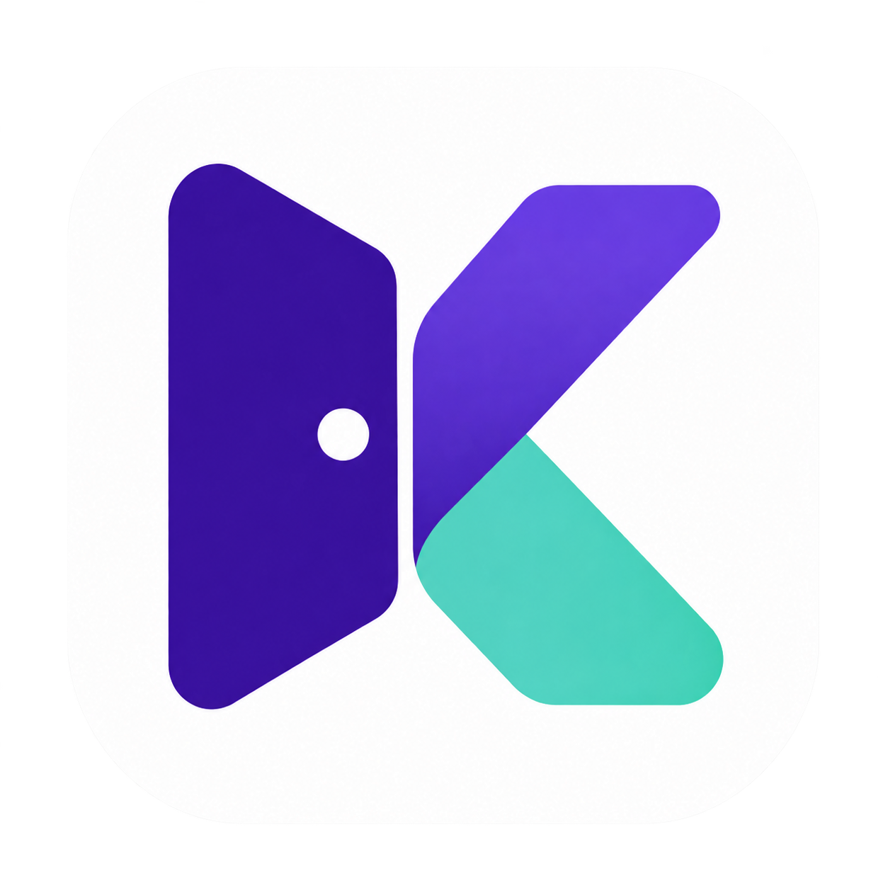

<p align="center">
  
</p>
<h1 align="center">KoKo</h1>
<p align="center">
  <strong>A zero-public-exposure remote desktop for LANs, Tailscale / ZeroTier networks, and AI agents</strong>
</p>
<p align="center">
  <a href="https://github.com/Kizai/koko/releases">Download the preview</a> ·
  <a href="#quick-start">Install and use</a> ·
  <a href="./README.md">Documentation</a> ·
  <a href="../README.md">简体中文</a>
</p>

---

## Why KoKo?

Traditional internet remote-desktop tools depend on cloud signaling and high-bandwidth relay servers. That has two costs. **Anything exposed to the public internet is an easy target now that AI makes automated attacks cheap**, and every signaling or relay server is one. Relayed traffic also brings stutter, throttling, and connections you cannot control.

**KoKo drops cloud relays entirely: No Cloud, No Relay.** Its peer-to-peer core is built with **Rust and iroh / QUIC**, for **LANs, Tailscale / ZeroTier overlay networks, and isolated company or school networks**. You keep the network boundary on a network you trust, and KoKo puts its effort into image quality, latency, and safe AI control.

This is a design choice, not a temporary limitation. Remote sessions never pass through a KoKo or third-party server. The two devices connect directly by IP, and KoKo keeps working on a network with no internet access at all. Only the update check contacts GitHub Releases.

## Core features

- **🔒 Zero public exposure: secure and stable (Zero-Cloud / Local-First)**
  No third-party cloud signaling or relay servers, so there is no public attack surface and no relay bandwidth bottleneck. KoKo discovers devices on the LAN, pairs with a 9-digit device ID and a verification code, and reconnects trusted devices. It works with **Tailscale, ZeroTier, WireGuard**, and isolated company or school networks. The verification code is only sent as a proof bound to both device keys, and repeated wrong codes lock checks for a while.

- **⚡ Native image quality and responsive input**
  KoKo uses the native macOS pipeline (ScreenCaptureKit / VideoToolbox / AVFoundation). It supports full-chroma **HEVC 4:4:4 FullRange** encoding, **30–240 FPS** target frame rates, and **AAC-ELD** audio with 10 ms frames. `⌘C / ⌘V` moves text, images, files, and folders of any size between the Macs, and the system's SSH provides Terminal and port forwarding.

- **🤖 A human-in-the-loop control plane for AI agents (MCP)**
  People and agents share the same Rust authorization layer. A built-in MCP server lets agents take screenshots, read UI elements, and use the mouse and keyboard. Guardrails address the main Computer Use risks. **Deleting, paying, quitting apps, running terminal commands, and other risky actions need the host's approval.** Touching the host's own mouse or keyboard pauses the agent at once and hands control back to a person.

## Use cases

- **Multiple Macs and homelabs**: control a Mac Studio or Mac mini from a laptop over the LAN or Tailscale, with 4:4:4 clarity close to a local display.
- **Hosting local AI agents**: let agents such as Claude or Codex take over an idle machine on your network for automated tasks, under your control, ready for you to take over at any time.
- **Sensitive networks and computer labs**: keep design and video assets inside the studio network, and support company R&D networks, school labs, and other offline or zero-exposure environments.

## Current release

The first preview supports **macOS 13 and later**, as a universal DMG for Apple Silicon and Intel. Use it on the same LAN, or on an overlay network where both devices can reach each other directly (Tailscale, ZeroTier, WireGuard, corporate VPN, and similar).

| Feature | Available now |
| --- | --- |
| Pairing | 9-digit device ID + verification code, LAN discovery, direct invitations for overlay networks, trusted reconnection |
| Remote desktop | Hardware HEVC (4:4:4 / 4:2:0 FullRange) and H.264 streaming, low-latency `AAC-ELD` remote audio, multiple displays, view-only mode, mouse and keyboard (including modifier keys and input-source switching) |
| Session clipboard | `⌘C` / `⌘V` move text, images, files, and folders both ways; large files stream continuously with no size limit (0.1.22 or newer on both Macs) |
| Sending from the host | Dragging files on the host shows a send panel; drop files there to send them to the controller (0.1.22 or newer on both Macs) |
| Picture settings | Stream resolution, quality, 30–240 FPS targets, and the measured receive rate |
| Device tools | Single-file transfer, Terminal, and localhost port forwarding in both directions, through the system SSH |
| Agent access | MCP: device list, pairing, screenshots, UI elements, mouse and keyboard, and asking the host for help. Risky actions need the host's approval. The host can stop or take over an agent at any time, and local mouse or keyboard input pauses it. A CLI covers discovery, pairing, screenshots, and input |

## Quick start

### 1. Download and install

Open the preview on [GitHub Releases](https://github.com/Kizai/koko/releases) and download `Koko-<version>.dmg`. Open the same DMG on both Macs, double-click the installer icon, and follow the macOS installer. Then open KoKo from Applications.

KoKo checks GitHub Releases at most once a day when it opens or returns to the main window. When a new version is available, choose **View and Update**, then **Update Now**; one progress bar covers download, verification, and installation, and KoKo relaunches when done. You can also check from **Settings → General → Check for Updates**. Users on 0.1.20 or earlier must install 0.1.21 from the DMG once; later versions update in the app. [Permissions and signing](./macos-permissions.md)

### 2. Share the host

1. On first launch, follow the permission guide. **Screen Recording** shares the screen, and **Accessibility** receives mouse and keyboard input. You can reopen the guide from **Settings → Security → Permissions**.
2. Turn on **Allow Remote Assistance** under local sharing. KoKo listens on `0.0.0.0:27688/UDP` by default and moves to the next free port if that one is taken. If macOS asks for Local Network access on either Mac, allow it.

### 3. Connect from the controller

| Situation | What to do |
| --- | --- |
| Same LAN | Refresh the sidebar, select the device, and choose **Enter Desktop**. The host chooses **Allow Once** or **Trust and Connect**. |
| You have the device ID and code | Enter the host's 9-digit device ID under **Connect to a Partner**, then the verification code. The temporary code changes after each session; the host can also set a custom code of 8–16 characters with letters and digits. After 5 wrong codes the host pauses checks for a while. |
| Tailscale / ZeroTier, or LAN discovery fails | Copy the direct invitation on the host and paste it under **Connect to a Partner**. The controller must be able to reach the host's UDP port (27688 by default). |

After connecting, click the remote screen to use the mouse and keyboard. Switch displays at the top, and adjust quality, resolution, or frame rate in the **Control Center**. Turning off **Allow Remote Assistance** on the host ends the session. [Full two-Mac guide](./macos.md)

## FAQ

- **Connected but no picture.** Run **Test Local Screen** on the host. If the system switch is on but KoKo still shows "not authorized" after an upgrade, check that macOS recorded the current app in Applications. [Permission troubleshooting](./macos-permissions.md)
- **I can see the screen but cannot click.** Check Accessibility on the host and open a controllable session with **Enter Desktop**. Click the picture first to give it keyboard focus.
- **The actual frame rate is below the target.** Keep the host's screen scrolling, then read the receive rate in the network status at the top. It depends on display updates, encoding, and the network.
- **How do I switch the remote input source?** Press Caps Lock or choose **Shortcuts → Switch Input Source**. Control-Space is taken by the controller's own macOS. [Key mapping](./macos.md#画面与按键映射)
- **How do I transfer files or open a terminal?** Open the tool from the device card. The host needs **Remote Login** enabled for the account. Transfers and forwarding use SSH keys and a verified host key. [Device tools](./macos.md#设备工具与设置)

## Architecture

| Layer | Implementation |
| --- | --- |
| Protocol and transport | Rust: `koko-proto` defines messages; `koko-p2p` authenticates and transports over iroh / QUIC with `presets::Minimal` (no relay, no external address lookup, direct IP only) and discovers LAN devices over mDNS |
| Sessions and CLI | Rust: `koko-daemon` runs host sessions and authorization; `koko-agent` is the controller CLI and MCP server and carries video and input |
| Native macOS layer | Swift / SwiftUI for windows and permissions; ScreenCaptureKit capture, VideoToolbox encoding, AVFoundation display, and Core Graphics input |

Low memory use and low latency are project goals, measured across the whole path: helper processes, encoding, decoding, and frame buffers. [Architecture and roadmap](./architecture.md#性能边界)

## CLI and agents

The Rust CLI ships inside the app. Replace the ID in the second command with the host's 9-digit device ID or a direct invitation.

```bash
/Applications/Koko.app/Contents/Helpers/koko-agent discover
/Applications/Koko.app/Contents/Helpers/koko-agent pair 253153157
```

Pairing returns `host_id` and `address`, which scripts use for authorized screenshot and input requests. [CLI and MCP](./macos.md#agent-与-mcp)

## Build from source

Install the [Rust toolchain](https://rust-lang.org/tools/install/) and the Xcode Command Line Tools, then clone and build.

```bash
git clone https://github.com/Kizai/koko.git
cd koko
./scripts/build-macos.sh --allow-ad-hoc
```

Local test builds appear under `target/koko-macos/local/`. [Building and signing](./macos.md#公开分发与升级)

```bash
cargo fmt --all -- --check
cargo clippy --workspace --all-targets --locked -- -D warnings
cargo test --workspace --locked
```

## Roadmap and contributing

KoKo will not add public relays or cloud signaling; reaching other networks is left to overlay networks you control, such as Tailscale and ZeroTier. Next:

- **Intranet image quality and latency**: send each video frame independently and drop stale ones, adapt the bitrate to the network in real time, and push toward high frame rates at 1440p.
- **Agent capabilities**: MCP already covers screenshots, UI reading, mouse and keyboard, and asking for help, with host approval for risky actions. Next come two-Mac acceptance tests and resource measurements.
- **More platforms and intranet management**: after the macOS experience is polished, Windows / Linux hosts, plus batch deployment, central management, and auditing for company networks and school labs.

Send feedback through [Issues](https://github.com/Kizai/koko/issues) with your KoKo and macOS versions, connection method, steps to reproduce, and expected result. Leave out verification codes and private keys. Read the [development rules](./development.md) before contributing.

## License

KoKo is licensed under the [GNU General Public License, version 3](../LICENSE).
